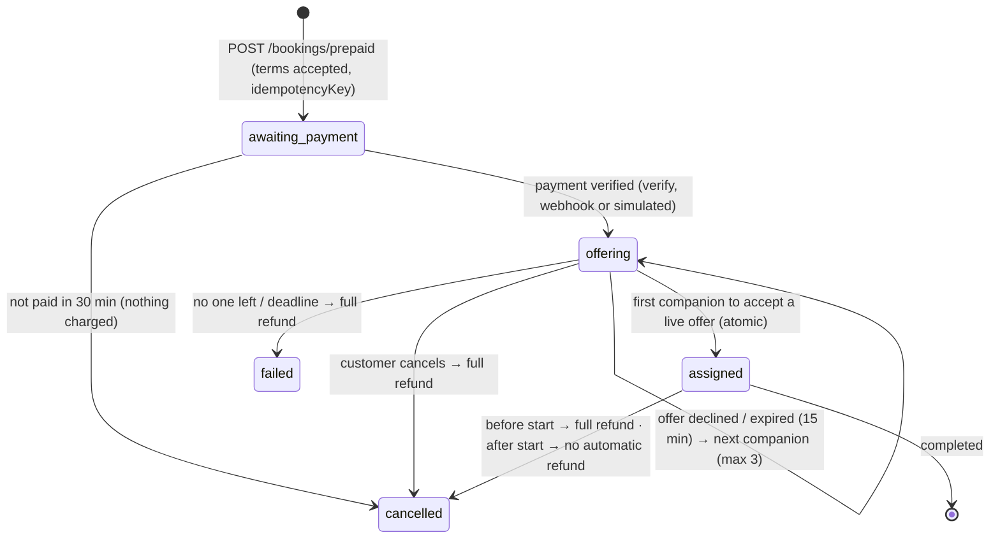

# prsnn API used by the app

Base: `EXPO_PUBLIC_API_URL` (default `https://prssn-backend.onrender.com/api`).
Auth: `Authorization: Bearer <JWT>` (7-day expiry). Errors are JSON
`{ message }`, and the app shows `message` as is.
Client: `src/services/backend.ts`. Types: `src/domain/types.ts`.

**New** marks endpoints added for the app on backend branch
`claude/quirky-ramanujan-k68143`.

## Auth

| Method & path | Body | Returns | Notes |
|---|---|---|---|
| POST `/auth/phone/send-otp` **New** | `{ phone, channel?: 'whatsapp'\|'sms' }` | `{ message, channel, expiresIn }` | 8/15 min per IP; 30 s resend cooldown |
| POST `/auth/phone/verify-otp` **New** | `{ phone, otp, role?: 'user'\|'companion' }` | `{ token, user, isNewUser }` | Creates the account on first verify; 5 tries per code |
| POST `/auth/pin/set` **New** 🔒 | `{ pin }` | `{ message }` | 4 digits, weak PINs refused |
| POST `/auth/pin/login` **New** | `{ phone, pin }` | `{ token, user }` | Locks for 15 min after 5 wrong tries |
| POST `/auth/login` | `{ email, password }` (email or username) | `{ token, user }` or 403 `{ emailVerificationRequired, email }` | Web accounts |
| POST `/auth/verify-email` | `{ email, otp }` | `{ token, user }` | |

`phone` is any Indian mobile format; the server normalises it to `91XXXXXXXXXX`.

`user` = `{ id, email?, username, role, is_verified, verification_status, fullName, profilePhoto, phone?, hasPin? }`

## Companions (public, viewer-aware)

| GET `/companions?limit=100&city=` | verified companions, filtered for the viewer (send the JWT if logged in) |
| GET `/companions/:id` | one companion (404 if not verified or outside the viewer's gender preference) |
| GET `/companions/search/:q` | name, bio, tags, area, city (input escaped) |

**Gender filter (server-enforced).** A logged-in viewer sees only companions whose `gender`
matches their `seeGender` (`woman`/`man`/`nonbinary`), or everyone if `seeGender` is
`everyone`. Logged-out viewers may pass `?see=`; otherwise they see everyone.

**Profile lock.** A companion with `profileVisibility: 'locked'` comes back with
`locked: true`, `profilePhoto: null` and first name only. A viewer with a confirmed, paid booking
with them gets the full profile. The same rule hides a member's photo from companions
until a booking between them is confirmed and paid. The app shows a static blurred placeholder
(`assets/images/locked.jpg`), never a blurred copy of the real photo.

## Prepaid bookings 🔒 (app) **New**

Website bookings keep the request → accept → pay flow below. The app pays first:



| Method & path | Who | Body / result |
|---|---|---|
| GET `/bookings/prepaid/policy` | anyone | fees, matching rules, cancellation and refund terms (shown before payment) |
| POST `/bookings/prepaid` | member | `{ companionId, scheduledDate, startTime, duration, idempotencyKey, acceptTerms: true, message?, city?, area? }` → `{ booking, quote: { amount, fees: 0 }, policy }`. Same key again → same booking (`replayed: true`) |
| POST `/bookings/:id/offer/accept` | companion | 200 confirmed · 409 expired, taken or time clash |
| POST `/bookings/:id/offer/decline` | companion | next companion is offered straight away |
| POST `/bookings/:id/cancel` | either party | prepaid: refund follows the policy, returns `{ refund }` |
| POST `/bookings/:id/dispute` | either party, paid bookings | `{ reason }` (≥10 chars) → emailed to `SUPPORT_EMAIL`; never blocked by payment |

Rules: the session must be ≥90 min away. Payment is applied once (atomic `markPaid`).
There is one live offer at a time; acceptance is a single conditional update on a live,
unexpired offer, so only one companion can win. Deadline = min(paid + 2 h, start − 1 h).
Refunds are claimed atomically (never twice) and retried. Backups must be in the same city,
match the customer's gender preference, be free at that time, and charge the same or a lower
rate than was paid. The customer never sees which other companions were offered (only
`offerSummary: { tried, liveUntil }`). A companion sees only `myOffer`. Booking state
(`status` + `allocation.state`) and payment state (`paymentStatus` + `refund`) are separate
fields. A background sweep every 30 s expires offers, moves to the next companion and fails
bookings past their deadline.

Tunable in backend env: `OFFER_TTL_MINUTES=15`, `ALLOCATION_TIMEOUT_MINUTES=120`,
`PAYMENT_TIMEOUT_MINUTES=30`, `MAX_COMPANION_OFFERS=3`.

## Bookings 🔒 (website request flow, unchanged)

| Method & path | Who | Body |
|---|---|---|
| POST `/bookings/request` | member | `{ companionId, scheduledDate: 'YYYY-MM-DD', startTime: 'HH:MM', duration: '30'…'240', message? }` |
| GET `/bookings/my-requests` | member | |
| GET `/bookings/incoming-requests` | companion | |
| GET `/bookings/:id` | either party | |
| PUT `/bookings/:id/status` | companion | `{ status: accepted\|rejected\|completed\|cancelled }` |
| POST `/bookings/:id/cancel` | either party | |
| GET `/bookings/:id/messages?limit&before` | either party (member must have paid) | |

The server checks that the companion offers that weekday, that the start
time falls inside `startTime`–`endTime`, and that a price is set.

## Payments 🔒

| POST `/payments/create-intent` | `{ bookingId }` → `{ mode, orderId, amount (paise), currency, keyId? }` | booking must be `accepted`, unpaid; `mode` is `simulated` or `razorpay` |
| POST `/payments/simulate` **New** | `{ bookingId, outcome?: 'success'\|'failure' }` | only when the server runs `PAYMENT_MODE=simulated`; same ownership/state rules; marks paid with `paymentMode: 'simulated'` |
| POST `/payments/verify-payment` | `{ bookingId, razorpayOrderId, razorpayPaymentId, razorpaySignature }` | checks signature, order ↔ booking, captured, amount ≥ due |
| POST `/payments/webhook` **New** | Razorpay → server, raw body signed with `RAZORPAY_WEBHOOK_SECRET` | `payment.captured` marks paid (amount checked); `refund.processed` marks refunds done. The source of truth if the app closes mid-payment |

**Simulated payments.** Until Razorpay is switched on, set `PAYMENT_MODE=simulated` on the
backend (testing service only: the website needs real Razorpay orders). The app reads `mode`
from create-intent and shows a test checkout clearly marked "no money will be taken". Switching
the backend to `razorpay` turns on real checkout with no app update.

**WhatsApp booking updates** (best effort, after the in-app notification): booking request →
companion, accepted → member (pay prompt), paid → companion. See WHATSAPP_TEMPLATES.md.

## Notifications 🔒

| GET `/notifications` | newest first |
| DELETE `/notifications/clear` | |

## Profile 🔒

| GET `/profile` | own profile (private fields stripped) |
| GET `/profile/check` | `{ hasProfile, status, is_verified, role }` |
| PUT `/profile/update` (multipart) | `fullName, city, state, area, phoneNumber, description, pricePerHour (1–1000), startTime, endTime, <day>_availability, tags, profilePhoto`, plus `gender`, `seeGender`, `profileVisibility` (needs `visibilityConsent: true`; the consent time is stored) |
| POST `/profile/onboard-companion` (multipart) | all companion fields + `profilePhoto, idProofFront, idProofBack, backupPhoto?` → status `pending` |
| DELETE `/profile` **New** | delete own account (members and companions) |

## Socket.io (chat)

Connect to `EXPO_PUBLIC_SOCKET_URL` with `auth: { token }`.

| Emit | Payload | Server replies |
|---|---|---|
| `join_room` | `{ bookingId }` | `previous_messages` (array) or `error` |
| `send_message` | `{ bookingId, message }` (≤1000 chars) | `receive_message` to both sides |
| `cancel_session` | `{ bookingId }` | `session_cancelled` to the room |

Phone numbers (10+ digits) in the other person's messages arrive as `••••••••••`.

## Backend environment for phone login

```
WAPLIFY_API_KEY=wapl_...          # Waplify dashboard
WAPLIFY_TEMPLATE_NAME=...         # Meta-approved AUTHENTICATION template
WAPLIFY_CODE_KEYS=1               # body_data keys for the code
MSG91_AUTH_KEY= / MSG91_TEMPLATE_ID=   # optional SMS backup (DLT)
WAPLIFY_TPL_BOOKING_REQUEST=prsnn_booking_request
WAPLIFY_TPL_BOOKING_ACCEPTED=prsnn_booking_accepted
WAPLIFY_TPL_PAYMENT_RECEIVED=prsnn_payment_received
WAPLIFY_TPL_BOOKING_CONFIRMED=prsnn_booking_confirmed
WAPLIFY_TPL_BOOKING_UNFULFILLED=prsnn_booking_unfulfilled
PAYMENT_MODE=simulated            # or razorpay
RAZORPAY_WEBHOOK_SECRET=          # when Razorpay is on
SUPPORT_EMAIL=admin@prsnn.com     # dispute reports
```
