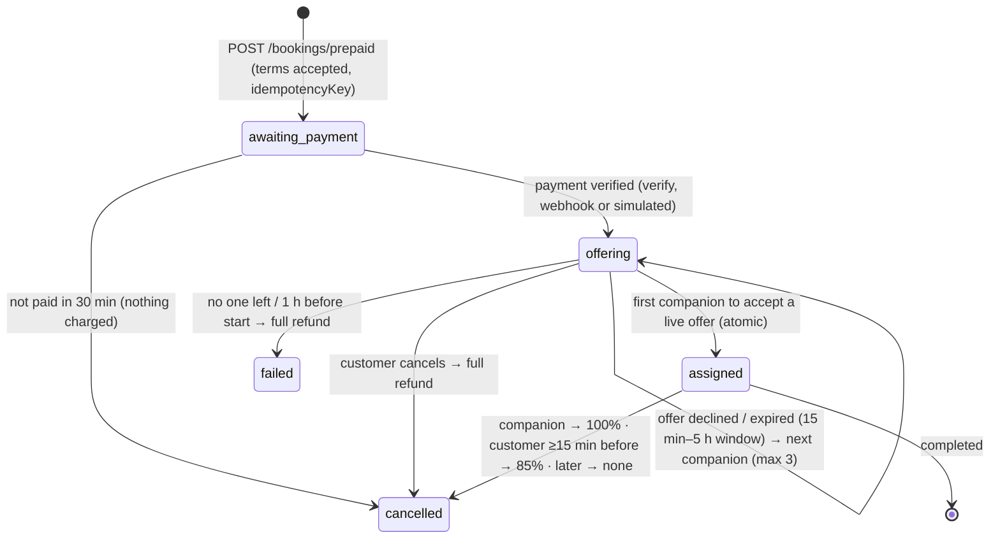

# prsnn API (Supabase)

Project `prsnn` · ref `mhovyhapzhxcmcuelbol` · Mumbai (`ap-south-1`).
SQL and edge functions: `qwink-dinein/prsnn-backend/supabase` (migrations are the source of truth).
Client: `src/services/backend.ts` via `src/lib/supabase.ts`. Types: `src/domain/types.ts`.

Every call is `supabase.rpc(name, args)` to a **security-definer** function that checks
`auth.uid()` and the caller's current role, or a table read behind row-level security. Errors
come back as `{ message }`; the app shows it as is. Logged-out visitors can call only
`list_companions`, `get_companion` and `booking_policy`, and read `settings`.

## Auth

| Step | Call | Notes |
|---|---|---|
| Send code | `auth.signInWithOtp({ phone: '+91…', options: { channel: 'sms', data: { role, otp_channel } } })` | Supabase makes the code; the **Send SMS hook** (`functions/send-sms`) delivers it on WhatsApp (Waplify), SMS (MSG91) as backup. `role: 'companion'` only matters on first sign-up |
| Verify | `auth.verifyOtp({ phone, token, type: 'sms' })` | Creates the account on first verify (trigger → `profiles`; members `verified`, companions `not_submitted`) |
| After every login | `rpc('sync_my_role')` → session user | Applies the superadmin phone list (`private.superadmin_phones`), refuses suspended accounts |
| PIN | on the device only (`src/lib/pin.ts`) | Salted SHA-256 in Keychain/Keystore unlocks the stored session; 5 wrong → OTP again |

Session user: `{ id, role, phone, fullName, is_verified, verification_status, profilePhoto, gender, seeGender, profileVisibility, city, suspended }`.

## Profiles

| RPC | Body | |
|---|---|---|
| `me()` / `my_profile()` | | session shape / full own row |
| `update_my_profile(p)` | `fullName, city, state, area, description, gender, seeGender, profileVisibility (+ visibilityConsent: true), tags, packages (1–12), availability {monday…}, startTime, endTime, photoPath` | whitelisted; times inside the day window |
| `submit_companion_application(p)` | above + `photoPath, idFrontPath, idBackPath, selfiePath?` | → `pending`; staff accounts refused |
| `save_push_token(token)` | Expo token or null | a token moving to another account is removed from the old one |
| `delete_my_account()` | | refused while a paid booking is open; keeps a `deleted_accounts` row |

**Storage.** `avatars/<uid>/…` (public) and `verification/<uid>/…` (private: owner + staff, signed links).
You can only write your own folder. JPG/PNG/WebP/HEIC, 8 MB.

## Companions (privacy applied on the server)

| RPC | |
|---|---|
| `list_companions(see?)` | verified, not suspended, filtered by the viewer's “show me”; locked profiles → first name, no photo, `locked: true` until a confirmed, paid booking together |
| `get_companion(cid)` | same rules; “Companion not found.” otherwise |

## Prepaid bookings

Rules: the session must be ≥90 min away. Payment is applied once (atomic `markPaid`).
There is one live offer at a time; acceptance is a single conditional update on a live,
unexpired offer, so only one companion can win. Each offer window =
clamp((start − 1 h − now) ÷ 3, 15 min, 5 h); the overall deadline is start − 1 h.
Refunds are claimed atomically (never twice) and retried. Backups must be in the same city,
match the customer's gender preference, be free at that time, and offer the booked duration.
Prices are the same for every companion, so the customer always pays the checkout price;
any difference that could arise on reassignment is retained by the platform
(`platformShare` = amount − `companionShare`), never added to the payout or charged to the customer. The customer never sees which other companions were offered (only
`offerSummary: { tried, liveUntil }`). A companion sees only `myOffer`. Booking state
(`status` + `allocation.state`) and payment state (`paymentStatus` + `refund`) are separate
fields. The 30 s sweeper (`private.tick`) expires offers, moves to the next companion and fails
bookings past their deadline.

### Prices and refunds

`packagePrice` is fixed by duration (₹399 base; 1 h ₹399 · 2 h ₹699 · 3 h ₹999 · 4 h ₹1,299 ·
5 h ₹1,599 · 6 h ₹1,899 · 7 h ₹2,199 · 8 h ₹2,499 · 9 h ₹2,799 · 10 h ₹3,099 · 11 h ₹3,349 ·
12 h ₹3,599). `companionShare` = floor(80%) is set when a companion is assigned; the other 20%
is prsnn.'s share. `pricePerHour` is always 399 and is ignored on update.

| Cancelled by | When | `refund.amount` | `refund.retained` |
|---|---|---|---|
| customer | ≥15 min before start | 85% (rounded) | 15% |
| customer | <15 min before start or later | 0 | 100% |
| companion | any time | 100% | 0 |
| system (nobody accepted) | start − 1 h | 100% | 0 |

These are the **defaults**. A superadmin can change the package prices, the 80/20 split, the
cancellation fee and cutoff, the offer windows, the day window and the headline packages in
the app (Admin → Prices); see §Settings. Changes apply to new bookings only.

Server config (`private.config`, SQL editor): `payment_mode`, `max_offers` (3), `support_email`. Payment window 30 min.

| RPC | Who | |
|---|---|---|
| `booking_policy()` | anyone | fees, matching and refund terms from the prices in force |
| `create_prepaid_booking(p)` | member | `{ companionId, scheduledDate, startTime, duration: '60'…'720', idempotencyKey, acceptTerms: true, message?, city?, area? }` → `{ booking, quote, policy, replayed? }` |
| `payment_mode()` / `simulate_payment(bid, outcome)` | member | `simulated` until Razorpay is wired (`private.config`) |
| `accept_offer(bid)` / `decline_offer(bid)` | companion | atomic; clash with another confirmed booking refused |
| `cancel_booking(bid)` | either party | policy below |
| `complete_booking(bid)` | companion | after the session has started |
| `open_dispute(bid, reason)` | either party | paid bookings |
| `my_bookings()` / `incoming_bookings()` / `get_booking(bid)` | | customer sees `offerSummary`, companion only `myOffer` |

Chat: table `messages` (Realtime). Only the two people on a confirmed, paid booking can read or
write; staff can read it only when a dispute exists. Phone numbers are masked on insert.

`private.tick()` runs every 30 s (`pg_cron`): lapses unpaid bookings, expires offers → next
companion, fails bookings past the deadline (full refund), completes sessions 2 h after they end.

## Notifications and push

Table `notifications` (own rows; mark read; delete). Every new row is delivered by
`functions/notify` (cron, 30 s): Expo push to the person's device, and WhatsApp templates for
`booking_offer` (→ `WAPLIFY_TPL_BOOKING_REQUEST`), `booking_confirmed` and unfulfilled refunds.

## Settings

`settings` row `pricing` (public read): `{ packagePrices {1…12}, platformShare, cancellationFee,
cancellationCutoffMinutes, offerMinMinutes, offerMaxMinutes, dayStart, dayEnd, headlineHours }`.
Change with `admin_save_pricing(p, reprice_unpaid)` (superadmin; prices must rise with hours and
fall per hour). New bookings only; `reprice_unpaid` also moves bookings still awaiting payment.

## Admin (ADMIN_SPEC.md)

Roles: **superadmin** = phones in `private.superadmin_phones` (10 digits, added in the SQL editor;
promoted on OTP/PIN login, demoted at the next login once removed). **subadmin** = added by a
superadmin by phone. The website's `admin` role has sub-admin rights. Staff routes re-read the
account on every call, so a removed or suspended admin loses access at once. Sub-admins get
403 on every route marked 💰. Every action writes an `AuditLog { actorId, role, action, target,
before, after, at }` (changed fields only). Suspended accounts can't log in (403) and are hidden
from listings, search and offers.

| RPC | Who |
|---|---|
| `admin_overview()` (money for superadmin), `admin_verifications()`, `admin_decide_verification(uid, decision, note)` | staff |
| `admin_users(q, role_filter)`, `admin_user(uid)`, `admin_update_user(uid, p)`, `admin_suspend_user(uid, on_off, reason)`, `admin_delete_user(uid)` | staff (staff targets: superadmin only) |
| `admin_bookings(tab)`, `admin_booking(bid)`, `admin_booking_messages(bid)` (disputes only, logged), `admin_update_booking(bid, p)`, `admin_cancel_booking(bid, reason, refund_amount)`, `admin_reassign_booking(bid, cid)` | staff; a sub-admin cancel flags the refund for a superadmin |
| `admin_disputes(st)`, `admin_reply_dispute(bid, msg, to_whom)`, `admin_close_dispute(bid, resolution)` | staff |
| `admin_refund`, `admin_retry_refund`, `admin_mark_paid`, `admin_override_fee`, `admin_delete_booking` | 💰 superadmin |
| `admin_admins()`, `admin_add_admin(phone)` (invites a number that has no account yet), `admin_remove_admin(uid)` | 💰 superadmin |
| `admin_save_pricing`, `admin_audience()`, `admin_activity(before_at)`, table `broadcasts` | 💰 superadmin |
| `functions/broadcast` `{ audience, title, body }` | 💰 superadmin (checked inside) |

## Owner setup

See `prsnn-backend/supabase/README.md` (phone provider, Send SMS hook, secrets, superadmin numbers, test numbers).
