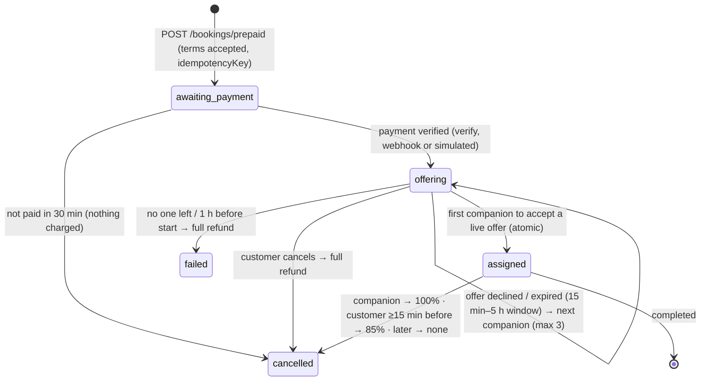

# prsnn API used by the app

Base: `EXPO_PUBLIC_API_URL` (default `https://prssn-backend.onrender.com/api`).
Auth: `Authorization: Bearer <JWT>` (7-day expiry). Errors are JSON
`{ message }`, and the app shows `message` as is.
Client: `src/services/backend.ts`. Types: `src/domain/types.ts`.

**New** marks endpoints added for the app on backend branches
`claude/quirky-ramanujan-k68143` and `claude/adoring-euler-w8jj3h` (admin, settings, push).

## Auth

| Method & path | Body | Returns | Notes |
|---|---|---|---|
| POST `/auth/phone/send-otp` **New** | `{ phone, channel?: 'whatsapp'\|'sms' }` | `{ message, channel, expiresIn }` | 8/15 min per IP; 30 s resend cooldown |
| POST `/auth/phone/verify-otp` **New** | `{ phone, otp, role?: 'user'\|'companion' }` | `{ token, user, isNewUser }` | Creates the account on first verify; 5 tries per code |
| POST `/auth/pin/set` **New** 🔒 | `{ pin }` | `{ message }` | 4 digits, weak PINs refused |
| POST `/auth/pin/login` **New** | `{ phone, pin }` | `{ token, user }` | Locks for 15 min after 5 wrong tries |
| POST `/auth/login` | `{ email, password }` (email or username) | `{ token, user }` or 403 `{ emailVerificationRequired, email }` | Web accounts |
| POST `/auth/verify-email` | `{ email, otp }` | `{ token, user }` | |

`phone` is any Indian mobile format; the server normalises it to `91XXXXXXXXXX`.

`user` = `{ id, email?, username, role, is_verified, verification_status, fullName, profilePhoto, phone?, hasPin? }`

## Companions (public, viewer-aware)

| GET `/companions?limit=100&city=` | verified companions, filtered for the viewer (send the JWT if logged in) |
| GET `/companions/:id` | one companion (404 if not verified or outside the viewer's gender preference) |
| GET `/companions/search/:q` | name, bio, tags, area, city (input escaped) |

**Gender filter (server-enforced).** A logged-in viewer sees only companions whose `gender`
matches their `seeGender` (`woman`/`man`/`nonbinary`), or everyone if `seeGender` is
`everyone`. Logged-out viewers may pass `?see=`; otherwise they see everyone.

**Profile lock.** A companion with `profileVisibility: 'locked'` comes back with
`locked: true`, `profilePhoto: null` and first name only. A viewer with a confirmed, paid booking
with them gets the full profile. The same rule hides a member's photo from companions
until a booking between them is confirmed and paid. The app shows a static blurred placeholder
(`assets/images/locked.jpg`), never a blurred copy of the real photo.

## Prepaid bookings 🔒 (app) **New**

Website bookings keep the request → accept → pay flow below. The app pays first:



| Method & path | Who | Body / result |
|---|---|---|
| GET `/bookings/prepaid/policy` | anyone | fees, matching rules, cancellation and refund terms (shown before payment) |
| POST `/bookings/prepaid` | member | `{ companionId, scheduledDate, startTime, duration: '60'…'720' (whole hours the companion offers), idempotencyKey, acceptTerms: true, message?, city?, area? }` → `{ booking, quote: { amount, fees: 0, hours, effectiveHourly }, policy }`. 400 if the session starts before 07:00 or ends after 22:00. Same key again → same booking (`replayed: true`) |
| POST `/bookings/:id/offer/accept` | companion | 200 confirmed · 409 expired, taken or time clash |
| POST `/bookings/:id/offer/decline` | companion | next companion is offered straight away |
| POST `/bookings/:id/cancel` | either party | prepaid: returns `{ refund: { amount, retained, reason } }` per the table below |
| POST `/bookings/:id/dispute` | either party, paid bookings | `{ reason }` (≥10 chars) → emailed to `SUPPORT_EMAIL`; never blocked by payment |

Rules: the session must be ≥90 min away. Payment is applied once (atomic `markPaid`).
There is one live offer at a time; acceptance is a single conditional update on a live,
unexpired offer, so only one companion can win. Each offer window =
clamp((start − 1 h − now) ÷ 3, 15 min, 5 h); the overall deadline is start − 1 h.
Refunds are claimed atomically (never twice) and retried. Backups must be in the same city,
match the customer's gender preference, be free at that time, and offer the booked duration.
Prices are the same for every companion, so the customer always pays the checkout price;
any difference that could arise on reassignment is retained by the platform
(`platformShare` = amount − `companionShare`), never added to the payout or charged to the customer. The customer never sees which other companions were offered (only
`offerSummary: { tried, liveUntil }`). A companion sees only `myOffer`. Booking state
(`status` + `allocation.state`) and payment state (`paymentStatus` + `refund`) are separate
fields. A background sweep every 30 s expires offers, moves to the next companion and fails
bookings past their deadline.

### Prices and refunds

`packagePrice` is fixed by duration (₹399 base; 1 h ₹399 · 2 h ₹699 · 3 h ₹999 · 4 h ₹1,299 ·
5 h ₹1,599 · 6 h ₹1,899 · 7 h ₹2,199 · 8 h ₹2,499 · 9 h ₹2,799 · 10 h ₹3,099 · 11 h ₹3,349 ·
12 h ₹3,599). `companionShare` = floor(80%) is set when a companion is assigned; the other 20%
is prsnn.'s share. `pricePerHour` is always 399 and is ignored on update.

| Cancelled by | When | `refund.amount` | `refund.retained` |
|---|---|---|---|
| customer | ≥15 min before start | 85% (rounded) | 15% |
| customer | <15 min before start or later | 0 | 100% |
| companion | any time | 100% | 0 |
| system (nobody accepted) | start − 1 h | 100% | 0 |

These are the **defaults**. A superadmin can change the package prices, the 80/20 split, the
cancellation fee and cutoff, the offer windows, the day window and the headline packages in
the app (Admin → Prices); see §Settings. Changes apply to new bookings only.

Tunable in backend env: `PAYMENT_TIMEOUT_MINUTES=30`, `MAX_COMPANION_OFFERS=3`, `SUPPORT_EMAIL`
(`OFFER_MIN_MINUTES` / `OFFER_MAX_MINUTES` now only seed the defaults).

## Bookings 🔒 (website request flow, unchanged)

| Method & path | Who | Body |
|---|---|---|
| POST `/bookings/request` | member | `{ companionId, scheduledDate: 'YYYY-MM-DD', startTime: 'HH:MM', duration: '60'…'720' (whole hours), message? }` |
| GET `/bookings/my-requests` | member | |
| GET `/bookings/incoming-requests` | companion | |
| GET `/bookings/:id` | either party | |
| PUT `/bookings/:id/status` | companion | `{ status: accepted\|rejected\|completed\|cancelled }` |
| POST `/bookings/:id/cancel` | either party | |
| GET `/bookings/:id/messages?limit&before` | either party (member must have paid) | |

The server checks that the companion offers that weekday, that the start
time falls inside `startTime`–`endTime` and the session runs between 07:00 and 22:00.
The price is the fixed package price.

## Payments 🔒

| POST `/payments/create-intent` | `{ bookingId }` → `{ mode, orderId, amount (paise), currency, keyId? }` | booking must be `accepted`, unpaid; `mode` is `simulated` or `razorpay` |
| POST `/payments/simulate` **New** | `{ bookingId, outcome?: 'success'\|'failure' }` | only when the server runs `PAYMENT_MODE=simulated`; same ownership/state rules; marks paid with `paymentMode: 'simulated'` |
| POST `/payments/verify-payment` | `{ bookingId, razorpayOrderId, razorpayPaymentId, razorpaySignature }` | checks signature, order ↔ booking, captured, amount ≥ due |
| POST `/payments/webhook` **New** | Razorpay → server, raw body signed with `RAZORPAY_WEBHOOK_SECRET` | `payment.captured` marks paid (amount checked); `refund.processed` marks refunds done. The source of truth if the app closes mid-payment |

**Simulated payments.** Until Razorpay is switched on, set `PAYMENT_MODE=simulated` on the
backend (testing service only: the website needs real Razorpay orders). The app reads `mode`
from create-intent and shows a test checkout clearly marked "no money will be taken". Switching
the backend to `razorpay` turns on real checkout with no app update.

**WhatsApp booking updates** (best effort, after the in-app notification): booking request →
companion, accepted → member (pay prompt), paid → companion. See WHATSAPP_TEMPLATES.md.

## Notifications 🔒

| GET `/notifications` | newest first |
| DELETE `/notifications/clear` | |

## Profile 🔒

| GET `/profile` | own profile (private fields stripped) |
| GET `/profile/check` | `{ hasProfile, status, is_verified, role }` |
| PUT `/profile/update` (multipart) | `fullName, city, state, area, phoneNumber, description, packages (array of whole hours 1–12), startTime, endTime (07:00–22:00), <day>_availability, tags, profilePhoto`, plus `gender`, `seeGender`, `profileVisibility` (needs `visibilityConsent: true`; the consent time is stored) |
| POST `/profile/onboard-companion` (multipart) | all companion fields + `profilePhoto, idProofFront, idProofBack, backupPhoto?` → status `pending` |
| DELETE `/profile` **New** | delete own account (members and companions) |
| PUT `/profile/push-token` **New** | `{ token: 'ExponentPushToken[…]' \| null }` — this device's Expo push token (null on sign-out). One per account; a token moving to another account is removed from the old one |

## Settings **New**

| Method & path | Who | Body / result |
|---|---|---|
| GET `/settings/pricing` | anyone | `{ packagePrices: { 1: 399 … 12: 3599 }, platformShare: 0.2, cancellationFee: 0.15, cancellationCutoffMinutes: 15, offerMinMinutes: 15, offerMaxMinutes: 300, dayStart: '07:00', dayEnd: '22:00', headlineHours: [1,2,4,6,12] }` · `Cache-Control: max-age=60`. The app applies it at start and every 5 min; it falls back to its bundled defaults |
| PUT `/admin/settings/pricing` | superadmin | any subset of the fields above, plus `repriceUnpaid?: boolean` → `{ message, pricing, repriced }`. 400 unless every longer package costs more in total and less per hour, shares are fractions (`platformShare` ≤ 0.5), `offerMax ≥ offerMin`, `dayEnd` ≥ `dayStart` + 1 h. Stored in `Settings { key: 'pricing' }`; each server instance reloads it within 60 s. `repriceUnpaid` moves prepaid bookings still `awaiting_payment` to the new prices; paid bookings never change |

## Admin 🔒 **New** (ADMIN_SPEC.md)

Roles: **superadmin** = phones in backend env `SUPERADMIN_PHONES` (comma-separated, 10 digits;
promoted on OTP/PIN login, demoted at the next login once removed). **subadmin** = added by a
superadmin by phone. The website's `admin` role has sub-admin rights. Staff routes re-read the
account on every call, so a removed or suspended admin loses access at once. Sub-admins get
403 on every route marked 💰. Every action writes an `AuditLog { actorId, role, action, target,
before, after, at }` (changed fields only). Suspended accounts can't log in (403) and are hidden
from listings, search and offers.

All paths below are under `/admin/app` unless shown in full.

| Method & path | Who | Body / result |
|---|---|---|
| GET `/overview` | staff | `{ pendingVerifications, liveBookings, openDisputes, refundsToReview, failedRefunds, members, companions, bookingsToday, money? }` — `money { collected, refunded, companionPayouts, platformNet }` for superadmins only |
| GET `/verifications` | staff | companions with `verificationStatus: 'pending'`, oldest first (with ID document URLs) |
| POST `/verifications/:id` | staff | `{ decision: 'verified' \| 'rejected', note? }` — notifies the companion |
| GET `/users?q=&role=user\|companion\|staff` | staff | up to 100; `q` matches name, username, email, city, or 4+ phone digits |
| GET `/users/:id` | staff | `{ user, bookings }` (20 latest) |
| PATCH `/users/:id` | staff | `fullName, city, area, state, description, gender, seeGender, profileVisibility, startTime, endTime, phoneNumber, tags, packages, availability` only. Staff targets: superadmin only |
| POST `/users/:id/suspend` | staff | `{ suspended: boolean, reason? }` |
| DELETE `/users/:id` | staff | 409 while they have a paid booking still open. Keeps a `DeletedAccount` row |
| GET `/admins` · POST `/admins { phone }` · DELETE `/admins/:id` | 💰 superadmin | list staff · make the number a sub-admin (creates the account if new) · back to member |
| GET `/bookings?tab=live\|refunds\|done` | staff | live = pending/accepted by date; refunds = review needed → failed → pending → processed; done = completed/cancelled/rejected. People populated; `companionShare`/`platformShare` for superadmins only |
| GET `/bookings/:id` | staff | full booking incl. offers, refund, dispute notes |
| GET `/bookings/:id/messages` | staff | the chat — only when the booking has a dispute (403 otherwise). Logged as `booking.read_chat` |
| PATCH `/bookings/:id` | staff | `{ scheduledDate?, startTime?, message?, city?, area?, status?: 'completed' }` — no money fields; reschedules notify both people |
| POST `/bookings/:id/cancel` | staff | `{ reason, refundAmount? }`. Sub-admin: no money moves; a paid booking gets `refundReview.needed` for a superadmin (403 if `refundAmount` is sent). Superadmin: refunds `refundAmount` (0…amountPaid) now |
| POST `/bookings/:id/reassign` | staff | `{ companionId }` — an active verified companion; amount paid and split unchanged |
| POST `/bookings/:id/refund` | 💰 | `{ amount, reason }` — full or partial; one refund per booking (409 after) |
| POST `/bookings/:id/refund/retry` | 💰 | retry a `failed` refund (up to 5 attempts) |
| POST `/bookings/:id/mark-paid` | 💰 | records the package price as paid, `paymentMode: 'simulated'`; a prepaid booking starts offering |
| POST `/bookings/:id/cancellation-fee` | 💰 | `{ retained }` on a cancelled, paid booking before its refund → refunds `amountPaid − retained` |
| DELETE `/bookings/:id` | 💰 | not while paid and open or while a refund is pending; deletes its chat |
| GET `/disputes?status=open\|resolved` | staff | bookings with that dispute status |
| POST `/disputes/:id/reply` | staff | `{ message, to?: 'both'\|'requester'\|'companion' }` — stored in `dispute.notes`, sent as notifications |
| POST `/disputes/:id/close` | staff | `{ resolution }` |
| POST `/notifications` · DELETE `/notifications/:id` | 💰 | `{ userId, message }` one in-app notification · remove one |
| GET `/broadcast/audience` | 💰 | `{ members, companions }` devices with a push token |
| POST `/api/admin/broadcast` | 💰 | `{ audience: 'members'\|'companions', title (2–65), body (2–240) }` → Expo push API in batches of 100; stores `Broadcast { audience, title, body, recipients, sent, failed, batches }`; tokens Expo reports as `DeviceNotRegistered` are removed |
| GET `/broadcasts` | 💰 | 50 latest |
| GET `/activity?before=<ISO>&action=<prefix>` | 💰 | audit log, 50 per page, newest first |

## Socket.io (chat)

Connect to `EXPO_PUBLIC_SOCKET_URL` with `auth: { token }`.

| Emit | Payload | Server replies |
|---|---|---|
| `join_room` | `{ bookingId }` | `previous_messages` (array) or `error` |
| `send_message` | `{ bookingId, message }` (≤1000 chars) | `receive_message` to both sides |
| `cancel_session` | `{ bookingId }` | `session_cancelled` to the room |

Phone numbers (10+ digits) in the other person's messages arrive as `••••••••••`.

## Backend environment for phone login

```
WAPLIFY_API_KEY=wapl_...          # Waplify dashboard
WAPLIFY_TEMPLATE_NAME=...         # Meta-approved AUTHENTICATION template
WAPLIFY_CODE_KEYS=1               # body_data keys for the code
MSG91_AUTH_KEY= / MSG91_TEMPLATE_ID=   # optional SMS backup (DLT)
WAPLIFY_TPL_BOOKING_REQUEST=prsnn_booking_request
WAPLIFY_TPL_BOOKING_ACCEPTED=prsnn_booking_accepted
WAPLIFY_TPL_PAYMENT_RECEIVED=prsnn_payment_received
WAPLIFY_TPL_BOOKING_CONFIRMED=prsnn_booking_confirmed
WAPLIFY_TPL_BOOKING_UNFULFILLED=prsnn_booking_unfulfilled
PAYMENT_MODE=simulated            # or razorpay
RAZORPAY_WEBHOOK_SECRET=          # when Razorpay is on
SUPPORT_EMAIL=mukarramjahmm@gmail.com   # dispute reports
OFFER_MIN_MINUTES=15 / OFFER_MAX_MINUTES=300   # defaults only; admins change them in the app
SUPERADMIN_PHONES=                # owner's two numbers, comma-separated, on Render only
EXPO_ACCESS_TOKEN=                # only if Expo "enhanced push security" is on
```
