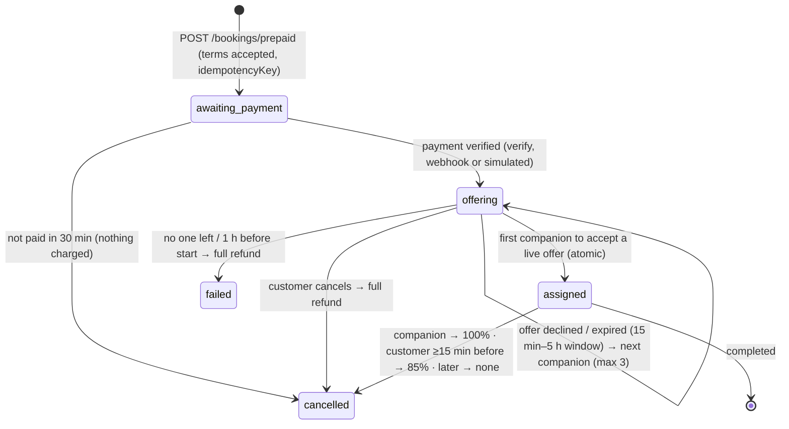

# prsnn API (Supabase)

Project `prsnn` · ref `mhovyhapzhxcmcuelbol` · Mumbai (`ap-south-1`).
SQL and edge functions: `qwink-dinein/prsnn-backend/supabase` (migrations are the source of truth).
Client: `src/services/backend.ts` via `src/lib/supabase.ts`. Types: `src/domain/types.ts`.

Every call is `supabase.rpc(name, args)` to a **security-definer** function that checks
`auth.uid()` and the caller's current role, or a table read behind row-level security. Errors
come back as `{ message }`; the app shows it as is. Logged-out visitors can call only
`list_companions`, `get_companion` and `booking_policy`, and read `settings`.

## Auth

| Step | Call | Notes |
|---|---|---|
| Send code | `auth.signInWithOtp({ phone: '+91…', options: { channel: 'sms', data: { role, otp_channel } } })` | Supabase makes the code; the **Send SMS hook** (`functions/send-sms`) delivers it on WhatsApp (Waplify), SMS (MSG91) as backup. `role: 'companion'` only matters on first sign-up |
| Verify | `auth.verifyOtp({ phone, token, type: 'sms' })` | Creates the account on first verify (trigger → `profiles`; members `verified`, companions `not_submitted`) |
| After every login | `rpc('sync_my_role')` → session user | Applies the superadmin phone list (`private.superadmin_phones`), refuses suspended accounts |
| PIN | on the device only (`src/lib/pin.ts`) | Salted SHA-256 in Keychain/Keystore unlocks the stored session; 5 wrong → OTP again |

Session user: `{ id, role, phone, fullName, is_verified, verification_status, profilePhoto, gender, seeGender, profileVisibility, city, suspended }`.

## Profiles

| RPC | Body | |
|---|---|---|
| `me()` / `my_profile()` | | session shape / full own row |
| `update_my_profile(p)` | `fullName, city, state, area, description, gender, seeGender, profileVisibility (+ visibilityConsent: true), tags, packages (1–12), availability {monday…}, startTime, endTime, photoPath` | whitelisted; times inside the day window |
| `submit_companion_application(p)` | above + `photoPath` (no ID) | → `id_required`: live straight away; staff accounts refused |
| `submit_id_documents(p)` | `idType` (`aadhaar`, `pan`, `driving_licence`, `passport`, `voter_id`), `idFrontPath`, `idBackPath` (Aadhaar, DL, voter ID), `selfiePath` — all in `verification/<uid>/` | → `pending`; companions only; refused once verified |
| `save_push_token(token)` | Expo token or null | a token moving to another account is removed from the old one |
| `delete_my_account()` | | refused while a paid booking is open; keeps a `deleted_accounts` row |

**Companion ID check — at the first booking, not at sign-up.** `verification_status`:
`not_submitted` (profile not finished) → `id_required` (live, listed, can be offered bookings) →
`pending` (ID sent) → `verified` | `rejected` (hidden from members until a new ID is approved).
`accept_offer` refuses with “Verify your ID to accept this booking.” until an ID is on file. A
`pending` companion who accepts **holds** the booking (`allocation.state = 'id_check'`,
`status` stays `pending`): no chat, no unlocked photos, no payout. Staff approval confirms every
held booking (chat opens); rejection re-offers each one to the next companion (or refunds in
full). A held booking still past its deadline (start − 1 h) is cancelled and refunded in full by
the sweeper. Cards carry `idVerified` so members see “New on prsnn” instead of the verified badge.

**Storage.** `avatars/<uid>/…` (public) and `verification/<uid>/…` (private: owner + staff, signed links).
You can only write your own folder. JPG/PNG/WebP/HEIC, 8 MB.

## Companions (privacy applied on the server)

| RPC | |
|---|---|
| `list_companions(see?)` | live (`id_required`, `pending` or `verified`; ID-verified first), not suspended, filtered by the viewer's “show me”; locked profiles → first name, no photo, `locked: true` until a confirmed, paid booking together |
| `get_companion(cid)` | same rules; “Companion not found.” otherwise |

## Prepaid bookings

Rules: the session must be ≥90 min away. Payment is applied once (atomic `markPaid`).
There is one live offer at a time; acceptance is a single conditional update on a live,
unexpired offer, so only one companion can win. Each offer window =
clamp((start − 1 h − now) ÷ 3, 15 min, 5 h); the overall deadline is start − 1 h.
Refunds are claimed atomically (never twice) and retried. Backups must be in the same city,
match the customer's gender preference, be free at that time, and offer the booked duration.
Prices are the same for every companion, so the customer always pays the checkout price;
any difference that could arise on reassignment is retained by the platform
(`platformShare` = amount − `companionShare`), never added to the payout or charged to the customer. The customer never sees which other companions were offered (only
`offerSummary: { tried, liveUntil }`). A companion sees only `myOffer`. Booking state
(`status` + `allocation.state`) and payment state (`paymentStatus` + `refund`) are separate
fields. The 30 s sweeper (`private.tick`) expires offers, moves to the next companion and fails
bookings past their deadline.

### Prices and refunds

`packagePrice` is fixed by duration (₹399 base; 1 h ₹399 · 2 h ₹699 · 3 h ₹999 · 4 h ₹1,299 ·
5 h ₹1,599 · 6 h ₹1,899 · 7 h ₹2,199 · 8 h ₹2,499 · 9 h ₹2,799 · 10 h ₹3,099 · 11 h ₹3,349 ·
12 h ₹3,599). `companionShare` = floor(80%) is set when a companion is assigned; the other 20%
is prsnn.'s share. `pricePerHour` is always 399 and is ignored on update.

| Cancelled by | When | `refund.amount` | `refund.retained` |
|---|---|---|---|
| customer | ≥15 min before start | 85% (rounded) | 15% |
| customer | <15 min before start or later | 0 | 100% |
| companion | any time | 100% | 0 |
| system (nobody accepted) | start − 1 h | 100% | 0 |

These are the **defaults**. A superadmin can change the package prices, the 80/20 split, the
cancellation fee and cutoff, the offer windows, the day window and the headline packages in
the app (Admin → Prices); see §Settings. Changes apply to new bookings only.

Server config (`private.config`, SQL editor): `payment_mode`, `max_offers` (3), `support_email`. Payment window 30 min.

| RPC | Who | |
|---|---|---|
| `booking_policy()` | anyone | fees, matching and refund terms from the prices in force |
| `create_prepaid_booking(p)` | member | `{ companionId, scheduledDate, startTime, duration: '60'…'720', idempotencyKey, acceptTerms: true, message?, city?, area? }` → `{ booking, quote, policy, replayed? }` |
| `payment_mode()` / `simulate_payment(bid, outcome)` | member | `simulated` until Razorpay is wired (`private.config`) |
| `accept_offer(bid)` / `decline_offer(bid)` | companion | atomic; clash with another confirmed or held booking refused; needs an ID on file; a companion whose ID is in review gets `{ idCheck: true }` and the booking is held (`id_check`) |
| `cancel_booking(bid)` | either party | policy below |
| `complete_booking(bid)` | companion | after the session has started |
| `open_dispute(bid, reason)` | either party | paid bookings |
| `my_bookings()` / `incoming_bookings()` / `get_booking(bid)` | | customer sees `offerSummary`, companion only `myOffer` |

Chat: table `messages` (Realtime). Only the two people on a confirmed, paid booking can read or
write; staff can read it only when a dispute exists. Phone numbers are masked on insert.

`private.tick()` runs every 30 s (`pg_cron`): lapses unpaid bookings, expires offers → next
companion, fails bookings past the deadline (full refund), completes sessions 2 h after they end.

## Notifications and push

Table `notifications` (own rows; mark read; delete). Every new row is delivered by
`functions/notify` (cron, 30 s): Expo push to the person's device, and WhatsApp templates for
`booking_offer` (→ `WAPLIFY_TPL_BOOKING_REQUEST`), `booking_confirmed` and unfulfilled refunds.
Every booking notice carries its `booking_id` (WhatsApp templates need the booking's date, time and
names). Until 17 Nov the companion's offer notice was saved without it, so its WhatsApp was skipped and only
the push went out; `next_offer` now saves the booking and the message reads "New paid 1-hour booking #REF …"
(migration `20261117080000_offer_notice_booking`, test `round10-offer-notice.sql`).
A WhatsApp counts as sent only when Waplify answers `status: "success"` (an HTTP 200 with an
error is retried, at most 5 attempts). Each send is logged in the function's logs as
`waplify sent <template> to=…1234` or `waplify failed <template> <status> <reason>`, and a message
skipped because its secret is missing is logged as `whatsapp skipped <type>: secret <NAME> is not set`.

## Settings

`settings` row `pricing` (public read): `{ packagePrices {1…12}, platformShare, cancellationFee,
cancellationCutoffMinutes, offerMinMinutes, offerMaxMinutes, dayStart, dayEnd, headlineHours }`.
Change with `admin_save_pricing(p, reprice_unpaid)` (superadmin; prices must rise with hours and
fall per hour). New bookings only; `reprice_unpaid` also moves bookings still awaiting payment.

## Admin (ADMIN_SPEC.md)

Roles: **superadmin** = phones in `private.superadmin_phones` (10 digits, added in the SQL editor;
promoted on OTP/PIN login, demoted at the next login once removed). **subadmin** = added by a
superadmin by phone. The website's `admin` role has sub-admin rights. Staff routes re-read the
account on every call, so a removed or suspended admin loses access at once. Sub-admins get
403 on every route marked 💰. Every action writes an `AuditLog { actorId, role, action, target,
before, after, at }` (changed fields only). Suspended accounts can't log in (403) and are hidden
from listings, search and offers.

| RPC | Who |
|---|---|
| `admin_overview()` (money for superadmin), `admin_verifications()` (companions holding a booking first, with `heldBookings` and `heldUntil`), `admin_decide_verification(uid, decision, note)` (approve → held bookings confirmed; reject → re-offered) | staff |
| `admin_users(q, role_filter)`, `admin_user(uid)`, `admin_update_user(uid, p)`, `admin_suspend_user(uid, on_off, reason)`, `admin_delete_user(uid)` | staff (staff targets: superadmin only) |
| `admin_bookings(tab)`, `admin_booking(bid)`, `admin_booking_messages(bid)` (disputes only, logged), `admin_update_booking(bid, p)`, `admin_cancel_booking(bid, reason, refund_amount)`, `admin_reassign_booking(bid, cid)` | staff; a sub-admin cancel flags the refund for a superadmin |
| `admin_disputes(st)`, `admin_reply_dispute(bid, msg, to_whom)`, `admin_close_dispute(bid, resolution)` | staff |
| `admin_refund`, `admin_retry_refund`, `admin_mark_paid`, `admin_override_fee`, `admin_delete_booking` | 💰 superadmin |
| `admin_admins()`, `admin_add_admin(phone)` (invites a number that has no account yet), `admin_remove_admin(uid)` | 💰 superadmin |
| `admin_save_pricing`, `admin_audience()`, `admin_activity(before_at)`, table `broadcasts` | 💰 superadmin |
| `functions/broadcast` `{ audience, title, body }` | 💰 superadmin (checked inside) |

## Owner setup

See `prsnn-backend/supabase/README.md` (phone provider, Send SMS hook, secrets, superadmin numbers, test numbers).

## Round 2 (2026-11-10)

**Sign-in.** Indian numbers: WhatsApp OTP as before. Visitors from abroad: `supabase.auth.signInWithOtp({ email })` →
`verifyOtp({ email, token, type: 'email' })` (Supabase Auth email OTP; the email template must contain `{{ .Token }}`).
The PIN is set straight after verification; email accounts key the PIN on the email. Setup then asks email sign-ups for
`contactPhone` (with country code) and `country`.

| RPC | Who | |
|---|---|---|
| `me()` | signed in | session shape + `email, photoStatus, photoNote, approvalStatus, approvalNote, state, area, categories, contactPhone, country` |
| `save_profile(p)` | signed in | `update_my_profile` keys + `categories` (subset of the five), `contactPhone`, `country`; a new `photoPath` → `photoStatus: pending` |
| `submit_companion_application(p)` | companion | needs a photo and ≥1 category; → `approvalStatus: pending` (staff notified); no ID |
| `resubmit_for_review()` | signed in | after changes were requested → `pending` again |
| `search_localities(state_name, q, city_name)` | anyone | India Post localities (156,912) in a state, by name or PIN; the city's district first; max 40 |
| `city_plans_for(city_name)` | anyone | staff-curated "Popular in <city>" plans |
| `create_prepaid_booking(p)` | member | + `category`, `meetingPlace` (required), `recipient { relation, name, phone, city, state }` |
| `raise_panic(bid)` | either party | from the session start to 1 h after the end, confirmed + paid only; alerts every admin now and every 5 min (sweeper) |
| `resolve_panic(aid, note)` | staff, or whoever pressed it | stops the repeats |
| `admin_approval_counts()`, `admin_approvals('companions' \| 'photos')` | staff | the approval queues |
| `admin_decide_profile(uid, 'approve' \| 'reject', note)` | staff | approve → live (photo approved too) |
| `admin_decide_photo(uid)` | staff | approve a photo |
| `admin_request_changes(uid, 'photo' \| 'profile', reasons[], note)` | staff | → `action_needed` notification with `{ kind: 'fix', target }` |
| `admin_panics(open_only)` | staff | alerts with names, numbers, time and place |
| `admin_city_plans(city)`, `admin_save_city_plan(p)`, `admin_delete_city_plan(id)` | staff | edit "Popular in <city>" |

**Listing.** A companion is listed only when `approvalStatus = approved` (and not suspended, ID not rejected). Photos are
shown to others only when `photoStatus = approved`. Cards carry `categories` and `idVerified`.

**Notifications** carry `action` (`fix`, `rejected`, `approved`, `photo_approved`, `review`, `panic`, `panic_resolved`);
types `action_needed`, `approval`, `panic`. Panic pushes use the Android channel `panic` with high priority.

**WhatsApp.** Panic alerts go through `private.whatsapp_outbox` → `claim_whatsapp()` → the `notify` edge function, template
`WAPLIFY_TPL_PANIC_ALERT` (WHATSAPP_TEMPLATES.md #7), to every staff number and the superadmin list.

## Round 3 (2026-11-14)

**Sessions last until the person ends them.** Supabase refresh tokens have no time limit on
this project, so a session never runs out on its own. The app keeps each person's refresh
token in the Keychain / Keystore (`src/lib/pin.ts`, `saveSession`) and the PIN reopens it.
**Log out only locks the app** (no `auth.signOut()`, which would revoke the session and force a
paid WhatsApp code). A code is needed again only after *Forgot PIN*, five wrong PINs, deleting
the account, or if the server reports the session gone (`sessionIsGone` in `src/domain/login.ts`;
network errors never log anyone out).

**WhatsApp audience.** `claim_notifications()` now returns `toRequester` (the recipient is the
member who booked) and `booking.place`. `functions/notify` sends `booking_offer` → companion only,
`booking_confirmed` → member only, unfulfilled `refund` → member only, `session_reminder` → both.

**5 AM reminder.** New notification type `session_reminder`, column `bookings.reminder_sent_at`,
`private.send_day_reminders()` (pg_cron `prsnn-day-reminders`, every 5 min): from 5:00 AM IST, every
accepted + paid booking that day, confirmed before 5 AM and not started yet, gets one row for the
member and one for the companion (push + `WAPLIFY_TPL_SESSION_REMINDER`). Sent once per booking.

**Panic alert details.** `private.panic_send` adds {{11}} duration + activity and {{12}} the alert
number and first-pressed time (12 variables, WHATSAPP_TEMPLATES.md #7); the staff push carries the
same. Email sign-ups' `contactPhone` is used when there is no login number.

Checks: `scripts/e2e-supabase.mjs` §9 and `prsnn-backend/supabase/tests/round3-notify.sql`
(one transaction, always rolled back).

## Round 4 (2026-11-15)

**Live badges.** `chat_reads (booking_id, user_id, last_read_at)` with RLS (own rows only).
`mark_chat_read(bid)`: participants only, never moves backwards. `unread_counts()` →
`{ notifications, messages, perChat: { bookingId: n }, bookings }` (members: bookings that need
payment; companions: live paid offers). The app recounts on Realtime events on `notifications`,
`messages`, `booking_offers` and `bookings` (all in the `supabase_realtime` publication, RLS
limits rows), on foreground and every 60 s (`src/lib/live.ts`). `profiles` is in the publication
too: a staff change to someone's profile (ID approved, suspended, role) reaches their phone in
seconds without logging out.

**ACID guarantees.** Every RPC runs in one Postgres transaction. Added:
- constraints: one live offer per booking (`booking_offers_one_live`), one open panic per booking,
  non-negative amounts, refund ≤ amount paid, companion share ≤ price, accepted ⇒ companion set;
- `select … for update` on the booking row before any change in `admin_delete_booking`,
  `admin_mark_paid`, `admin_override_fee`, `admin_refund`, `admin_retry_refund`, `complete_booking`,
  `open_dispute`, `simulate_payment`, `private.mark_paid` (accept/decline/cancel already used
  conditional updates with row-count checks);
- delivery outbox: `claim_notifications()` / `claim_whatsapp()` lease rows for 2 minutes (at most 5
  attempts); `functions/notify` reports what the provider accepted with
  `report_notifications([{id, push, wa, error?}])` / `report_whatsapp([{id, ok, error?}])`. A row is
  marked sent only after delivery; push and WhatsApp are tracked separately so a retry never
  repeats the channel that worked. Service role only.

**Staff app preview.** `admin_log_preview(as_role 'member'|'companion', start_at text)`: staff only;
writes `app.preview` to the activity log. The preview itself runs on the app's sample data
(`src/lib/preview.tsx`); nothing else reaches the server.

Checks: `scripts/e2e-supabase.mjs` §10 and `prsnn-backend/supabase/tests/round4-acid.sql`
(rolled back).

## Round 5 (2026-11-16) · state-machine fixes

**One companion, one schedule.** `private.lock_companion(cid)` (transaction lock per companion) is
taken by `next_offer`, `accept_offer` and `admin_reassign_booking` before they check overlaps, so
two parallel paths can't give one companion overlapping bookings or offers. `accept_offer` also
locks the companion's profile (`FOR SHARE`) before reading the ID status, so it can't interleave
with `admin_decide_verification`, and refuses companions who aren't live (suspended, approval
withdrawn: "Your profile isn’t live right now…"). `admin_reassign_booking` needs an approved, live,
verified companion with no overlapping booking or live offer.

**Suspending a companion** (`admin_suspend_user`) withdraws their live offers and offers bookings
held for their ID check to someone else (members are told). Confirmed bookings stay for staff.

**Panic.** `raise_panic` locks the booking: two presses at once return the same alert.

**Completion.** `complete_booking`: confirmed and paid, after the session has **ended**, no open
report, no open safety alert. `tick` completes paid bookings only; website requests accepted but
never paid are cancelled (`cancel_reason = 'not_paid'`) 2 h after their end.

**Payments.** A failed test payment sets `payment_status = 'failed'`; the booking stays payable until
its window closes. The app's `canPay` mirrors this.

**Profiles.** `admin_decide_profile` refuses a profile still in `draft` ("hasn’t been sent for review").

**Delivery.** `claim_notifications()` / `claim_whatsapp()` return a `claimToken` per row; `report_*`
items must carry it (`[{id, claimToken, …}]`), so a report for an expired claim is ignored. Rows out
of tries (5) or time (1 day; WhatsApp alerts 1 hour) get `gave_up_at`, and staff get one
`delivery_failed` notice per batch.

**Booking states.** Constraint `bookings_prepaid_states`: pending ⇔ awaiting payment / finding /
ID check; accepted, completed ⇔ assigned; cancelled ⇔ cancelled / failed.

**App.** Chat merges history with live messages and reloads it on every (re)connect; a failed send
puts the text back. Chat opens only on confirmed, paid bookings (`canChat`, both sides). "Mark
completed" shows only when `canComplete`. Sign-up restores the remembered step only after the
answers load, never over a tap, and never past the first unanswered question (`firstUnanswered`).
The companion dashboard shows "Paused by our team" when suspended.

Checks: `scripts/e2e-supabase.mjs` §11, `prsnn-backend/supabase/tests/round5-states.sql`
(13 checks, rolled back; all pass) and `round4-acid.sql` (updated for claim tokens; all pass).

## Round 6 (2026-11-16) · website, interest list, home visits

**Website interest list.** `public.enquiries (phone E.164 unique, interest member|companion|both,
source, submissions, created_at, updated_at)`, RLS on with no policies (no direct access).
`submit_enquiry(phone_number, interest_choice, src)`: anyone (anon) may call; Indian numbers must be
10 digits starting 6–9; one row per number (a repeat updates interest and counts, ignored within
10 s); throttled to 60 sign-ups a minute. `admin_enquiries(lim)`: staff only → `{ counts, items }`;
each item has `joinedApp` (that number has since signed up in the app).
`admin_signups(lim)` (migration `20261116150000_admin_signups.sql`): staff only → `{ counts: { total,
member, companion, setupDone, categories: { key: n } }, items: [{ id, fullName, phone (E.164), role,
categories, gender, seeGender, visibility, city, area, approvalStatus, verificationStatus, setupDone,
createdAt }] }`, newest first: what each member or companion chose when they signed up in the app.
In the app: Admin → Interested (tabs: Website, App sign-ups; a sign-up opens that user).

**Home visits.** `bookings.home_visit` (only when `category = 'loved_one'` and a recipient is set;
constraint `bookings_home_visit_loved_one`). `create_prepaid_booking` takes `homeVisit: true` and then
needs the full address (≥ 8 characters) as `meetingPlace`; otherwise a public place (≥ 3). In
`booking_json`, companions who are only being offered the booking see
`meetingPlace = "Home visit · <area>"`; the member, the confirmed companion and staff see the
address (`private.sees_address`). `homeVisit` is in the booking JSON. App: checkout shows "A public
place / At their home" for loved-one bookings made for someone else (`canHomeVisit`).

**Website** (`prsnn-frontend`): see its README for the pages and deploy settings, and
`seo/README.md` for the SEO/GEO plan.

Checks: `scripts/e2e-supabase.mjs` §12; rolled-back SQL checks run on the project (enquiries:
validation, one row per number, no anon read; home visits: address hidden from offered
companions, shown to member and confirmed companion, refused outside Loved One).

## Round 7 (2026-11-16): launch hardening

- `20261116160000_hardening.sql` (applied 2026-11-16). Companion browsing (`list_companions`, `get_companion`) for
  signed-in users only (no anonymous scraping); indexes on the foreign keys the advisors flagged;
  drops the duplicate `notifications_unpushed` index.
- `supabase/tests/round6-payment-flow.sql`: the whole booking on the simulated payment, as the e2e
  accounts (book → failed test payment → paid → offered → accepted → chat opens with numbers hidden →
  member notified). One transaction that always rolls back. **Not run yet** (same confirmation prompt).
- Chat "typing…" uses a Realtime broadcast on the booking's chat channel (`event: 'typing'`,
  `payload.from` = sender id). Nothing is stored.
- `payment_mode()` is read by the payment screen to show the "Test mode, no money moves" notice.

## Round 8 (2026-11-16): consent log and house rules

- `20261116170000_consents.sql` (applied 2026-11-16; 8 live checks pass, rolled back). Table `public.consents` (user_id, phone at
  the time, kind, version, booking_id, source app|web|system, user_agent, accepted_at, withdrawn_at), RLS on
  with no direct access; rows survive account deletion (user_id cleared).
  - `record_consents(kinds text[], ver text)` (signed in): kinds `terms`, `privacy`, `age_18`,
    `whatsapp_updates`, `house_rules`, `companion_terms`; same kind + version again is a no-op → `my_consents()`.
  - `my_consents()` → `[{ kind, version, acceptedAt }]`, latest per kind (booking terms excluded).
  - `admin_user_consents(uid)` (staff) → every agreement, newest first, with source and booking.
  - Server checks: a member can't create a booking without `house_rules`; a companion can't move to
    review (`approval_status → pending`) without `companion_terms` and `house_rules`.
  - Logged automatically: `booking_terms` on every booking a member makes, `photo_visibility` when
    `visibility_consent_at` changes, `enquiry_contact` (source web, phone) on the website interest form.
- App: sign-in records terms, privacy, 18+ (and WhatsApp for phone sign-ups) after the code is verified;
  the booking review's tick covers the house rules (recorded before the booking); companion application and
  resubmission record Companion Terms + house rules. `/rules` screen, Profile → House rules, Home card,
  Admin → user → Agreements.
- Same NOT_FOR / HOUSE_RULES text in `src/domain/rules.ts` and the website's `_lib/content.js`.

## Round 9 (2026-11-16): areas without PIN codes

- App: the area picker lists each area name once (no PIN), saves only the name, and every place line
  goes through `areaName()` (src/domain/places.ts), which strips a trailing 6-digit PIN from older data.
- `20261116180000_area_without_pincode.sql` (applied 2026-11-16 by the owner in the SQL editor; checked: 0 profiles and 0 bookings with a PIN):
  strips PINs already saved in `profiles.area` and `bookings.area`, and a trigger keeps them off. Until it's
  applied, staff screens that show raw areas may still show a PIN. (Done.)

## Round 10 (2026-11-16): real payments with Razorpay

- Migration `20261116190000_razorpay.sql` (applied; 8 live checks pass, rolled back). Service-role-only functions:
  `pay_prepare(bid, uid)` (amount in paise from the database), `pay_set_order`, `pay_confirm(order_id, payment_id,
  amount_paise)` (exact amount or the booking is flagged for staff, never marked paid; repeat calls are no-ops),
  `pay_failed`, `refunds_claim(lim)` (claimed once, 15-minute lease), `refunds_report`, `refunds_failed_by_provider`.
  pg_cron `send-refunds` every 2 minutes while Razorpay refunds are pending.
- Edge functions (deployed): `payments` (verify_jwt; `order` creates the Razorpay order, `verify` checks the
  checkout signature, fetches the payment from Razorpay, captures if only authorised, then `pay_confirm`),
  `razorpay-webhook` (no JWT; HMAC of the raw body with RAZORPAY_WEBHOOK_SECRET; payment.captured/failed,
  refund.processed/failed), `refunds` (sends queued refunds, speed normal).
- Secrets (Supabase → Edge Functions → Secrets, never the app or repo): RAZORPAY_KEY_ID, RAZORPAY_KEY_SECRET,
  RAZORPAY_WEBHOOK_SECRET. Switch on with `update private.config set value = 'razorpay' where key = 'payment_mode';`
  (back to 'simulated' to pause). The app reads `payment_mode()`; no app update needed to switch.
- App: `createPaymentIntent` / `verifyPayment` call `payments`; checkout stays Razorpay Standard Checkout in a
  WebView; UPI app links (upi://, intent://, phonepe://…) open the UPI app (`externalTarget`, src/domain/payments.ts).

## Round 11 (2026-11-16): no double bookings, live "View the app as"
Migration `20261116210000_no_double_booking_live_preview.sql`.
- `private.holds_companion(booking, cid)`: a booking holds a companion's time while the member is paying
  (`awaiting_payment`, 30-minute window), while it is offered to them (live offer), and once accepted / in ID check.
  `private.has_conflict` uses it, so offers skip a busy companion as before, now counting payment holds too.
- `create_prepaid_booking` locks the companion, then refuses an overlapping time: "<Name> is already booked at that
  time…" for everyone, and "You already have a booking at that time…" for the same member. A member's own unpaid,
  overlapping booking (they went back and chose again) is cancelled (`replaced_by_new_booking`) instead of blocking them.
- `companion_busy(cid uuid, d date) → [{ start, duration }]`: the taken times on a day, no names. The booking screen
  hides start times that would overlap (`freeSlots`, src/domain/booking.ts).
- `admin_view_as(target uuid, fn text, args jsonb)`: staff only. Runs one read as a real member or companion
  (`start`/`me`, `my_profile`, `my_bookings`, `incoming_bookings`, `get_booking`, `list_companions`, `get_companion`,
  `unread_counts`, `my_consents`, `notifications`), restoring the caller's identity afterwards. `start` is written to
  the activity log (`app.preview_live`). Anything else is refused; chats are not readable this way.
- App: Admin → View the app as → **Live data** picks a real person; the app's reads go through `admin_view_as`, every
  write is refused before it leaves the phone ("This is a live preview…"), and chats show "Chats are private". Exit or
  Log out returns to the staff account. **Sample data** is the old preview.

## Round 12 (2026-11-16): a full refund cancels an open booking
Migration `20261116220000_full_refund_cancels.sql`.
- `admin_refund(bid, amount, reason)`: refunding the **whole** amount on a booking that is still open (pending or
  accepted) now cancels it through `admin_cancel_booking` (open offers withdrawn, both people notified, logged as
  `booking.cancel` with reason "Full refund: …"); the result has `cancelled: true`. Partial refunds leave the booking open.
- Fix: `admin_cancel_booking` with a refund amount failed with "column reference refund_amount is ambiguous"
  (parameter and column share the name). It now uses the parameter by position.
- App: Admin → booking → Refund says that the full amount also cancels the booking.

## Round 13 (2026-11-16): production guards (no double bookings, payments, messages)
Migrations `20261116230000_production_guards.sql`, `20261116231000_fk_indexes_admin.sql`; edge functions
`payments`, `refunds`, `razorpay-webhook` redeployed. Test: `prsnn-backend/supabase/tests/round7-production-guards.sql`.
- **No overlapping sessions, guaranteed by the database:** `bookings.slot` (generated time range) and the exclusion
  constraint `bookings_companion_no_overlap` (same companion, overlapping slot, accepted or in ID check). Every path
  (booking, offer, accept, admin reassign) already checks; this makes a race impossible.
- `private.has_conflict` now reads only the companion's own bookings, payment holds and live offers (indexed).
- **Payments:** `private.payment_orders` remembers every Razorpay order per booking; `pay_prepare` returns the open
  order (`orderId`) and `payments` reuses it instead of creating a new one per checkout; `pay_confirm` matches any of
  the booking's orders (a late payment on an earlier order still confirms), ignores the same payment twice, and queues
  a **second payment** for an already-paid booking in `private.extra_payments` for a full automatic refund
  (`extra_refunds_claim` / `extra_refunds_report`, sent by `refunds`, member and staff told). Razorpay refund notes
  carry `kind: 'duplicate'` so the webhook never marks the booking itself refunded.
- **Messages:** the app gives each message its own UUID and inserts it with that id, so a double tap or a retry can't
  create two messages (the repeat hits the primary key and counts as sent); the send button locks instantly.

## Round 14 (2026-11-17): admins are told when an account is deleted
Migration `20261117060000_delete_notice.sql`. Test: `prsnn-backend/supabase/tests/round8-delete-notice.sql`.
- `private.delete_account` (used by `delete_my_account` and `admin_delete_user`) now notifies every admin, except the
  one who deleted it, in one line: name, role, city, mobile number, who deleted it and how long after signing up.
  Example: "Pankaj (companion, Delhi, +91 97850 72111) deleted his account himself, 50 min after signing up."
  Notification `type: 'other'`, `action: { kind: 'account_deleted', role, deletedId, phone }`.
- When a profile is deleted, earlier "to review" notices about it get "(Account since deleted.)" and lose their action,
  so they no longer open an empty approvals queue.
- No new data is kept (the number was already in `deleted_accounts`); the privacy policy is unchanged.
- Backfilled once for self-deletions in the last 7 days.
- App: tapping an `account_deleted` notice calls the number.

## Round 15 (2026-11-17): a deleted account's files are deleted too
Migration `20261117070000_purge_deleted_files.sql`; edge function `purge-files` (new, `verify_jwt: false`).
Test: `prsnn-backend/supabase/tests/round9-purge-files.sql`.
- Matches the privacy policy: profile photos (`avatars`) are removed right after the account is deleted;
  ID documents and selfie (`verification`) too, unless the person is part of an open safety case (an unresolved
  panic alert or dispute on one of their bookings). Those are removed once the case closes.
- `private.purgeable_files(lim)` lists files whose owner folder belongs to a `deleted_accounts` row with no live
  account. `public.purge_files_claim(lim)` exposes it to the service role only.
- Supabase blocks deleting `storage.objects` in SQL, so `purge-files` removes them through the Storage API.
  It is called by a trigger on `deleted_accounts` (after commit, via `pg_net`) and by pg_cron `purge-files`
  every 15 minutes while anything is waiting.
- Pankaj's leftover photo was removed when this went live.

## Round 16 (2026-11-17): admin "Money" counts real payments only
Migration `20261117090000_money_real_only.sql`.
- `admin_overview().money` sums only bookings with `payment_mode = 'razorpay'`; simulated test bookings (before
  going live, and any later) are left out. New field `money.since`: the first real payment's time.
- App: the card is titled "Money (real payments)".

## Round 17 (2026-11-17): people counts on the admin overview
Migration `20261117100000_people_counts.sql`.
- `admin_overview()` adds `allCompanions` (every companion account, any approval status; `companions` stays the
  ID-verified count) and `bothSides` (companions who have also booked someone: a paid or refunded booking as the
  customer, real or test). Helper `private.both_sides(uid)`.
- `admin_users(q, role_filter)` accepts `role_filter = 'both'`.
- App: Admin → "People" card with Members · Companions · Both; each opens Users with that filter
  (`/admin/users?role=user|companion|both`, new "Both" chip).
- e2e: the money check now expects simulated bookings to leave `money` unchanged (real payments only, round 16).

## Round 18 (2026-11-17): companion is told on WhatsApp when an ID approval confirms their booking
Edge function `notify` v20.
- Before: when an admin approved a companion's ID, the held paid booking was confirmed and the **member** got
  WhatsApp #5 `prsnn_booking_confirmed`, but the **companion** got only the in-app notice (and no push without a
  push token), because companion-side `booking_confirmed` had no WhatsApp.
- Now a companion-side `booking_confirmed` sends #4 `prsnn_payment_received` (amount, member's first name, date,
  time, ref; "booking confirmed, chat enabled"). Companions only get `booking_confirmed` when they didn't tap Accept
  (ID approval releasing a held booking, or support assigning it), so nobody gets a message about their own tap.
- Re-sent to the one companion affected today (2 bookings, both later the same day).

## Round 19 (2026-11-17): one chat per person; chat closes when the session ends
Migration `20261117110000_chat_window.sql`. Test: `prsnn-backend/supabase/tests/round11-chat-window.sql`.
- New `public.chat_open(b)`: the caller is on booking `b`, it is accepted and paid, and `now() < upper(slot)`
  (the session's end). Policy "chat write" on `messages` now uses it, so a message can be sent from confirmation
  (paid + accepted, i.e. after the ID check when there is one) until the session ends, from any app version.
- Reading is unchanged (`can_chat`): history stays visible after the session, and admins still read a disputed
  booking's chat by booking.
- App: messages still belong to a booking, but every confirmed booking between the same two people (same side)
  is one thread (`src/domain/chat.ts`: `chatOpen`, `chatThreads`, `threadOf`). The chat screen loads all of them,
  shows a divider per booking, sends to the open booking whose session ends first, and locks the box when none is
  open ("Your session has ended, so chat is closed."). Chats tab: one row per person with Open/Closed.
  "Chat" buttons on booking cards and the booking page show only while chat is open.
- A new booking with the same person reopens the same thread.

## Round 20 (2026-11-18): photos open by default, "Available today", photo viewer

- **Photo visibility.** Everyone now starts with an **open** photo (`domain/privacy.defaultVisibility`; women were locked by default
  before). Picking **Locked** in sign-up, companion onboarding or Privacy first shows the photo nudge
  (`components/PhotoNudge`: "Public photos get more bookings", main button "Keep my photo visible", "Lock it anyway" always there).
  Existing choices are unchanged. No backend change: the default lived in the app.
- **Visible photos rank first.** `domain/search.photosFirst`: on Search ("Recommended") and Home, companions with an uploaded,
  unlocked photo come first; order within each group is kept. Price sorts are unaffected.
- **`companions_busy(d date) → { companionId: [{start, duration}] }`** (migration `20261118090000_companions_busy_today`):
  every companion's taken times on one day, same rule as `companion_busy` (`private.holds_companion`), times only, signed-in
  callers. New index `bookings_scheduled_date`. Used by the **Available today** switch on Search: `domain/booking.freeToday`
  keeps a companion if they work today and a 1-hour session still fits in their hours after the 90-minute booking lead and
  their taken times; rows show "Free today · till 9 PM" or "4 PM – 9 PM". The switch starts off, glowing (pulse stops with
  reduced motion). e2e: checks the map and that only times come back.
- **Photo viewer.** Tapping a visible photo (Home card, Search row, profile) grows it into a large round photo over a dark
  backdrop (`components/PhotoViewer`, mounted once in `app/_layout`, opened with `lib/photoViewer.openPhoto`). Swipe down,
  tap outside or close to shrink it back. From a list it offers View profile and Book (`/companion/[id]?book=1` scrolls to
  the booking picker). Locked photos never open.

## Round 21 (2026-11-18): staff is a permission; prices back to normal

- **`profiles.staff_role`** (`subadmin` | `superadmin` | null) holds admin access; **`profiles.role` is only `user` or
  `companion`** (check constraint `profiles_role_market_check`). Before, one `role` value was all a person could be, so
  making a companion a sub-admin wiped their companion side and removing an admin made them a plain member.
  Migrations `20261118120000_staff_is_a_permission` and `20261118121000_audit_staff_role` (applied):
  - `is_staff()` / `is_superadmin()` / `need_staff()` read `staff_role`, so every RLS policy follows automatically;
    `need_staff()` returns the staff level (`admin_overview.role`, refund rights).
  - The two existing superadmins became `role = 'user'` + `staff_role = 'superadmin'`.
  - `handle_new_user`, `sync_my_role` (superadmin phone list), `admin_add_admin`, `admin_remove_admin` set or clear only
    `staff_role`; the member / companion side is never touched. Staff can apply as companions like anyone.
  - `me()` and `admin_user_json` return `staffRole`; `admin_users(role_filter => 'staff')` and `admin_admins` read it;
    staff alerts, staff phones, refund-failed notices and account-deleted notices go to `staff_role is not null`;
    the activity log records the staff level; live preview of a staff account stays refused.
- **App.** `domain/admin.staffLevel(person)` is the one "is this person staff?" check (reads `staffRole`, and an old staff
  value in `role`). Modes: `domain/mode.modesFor` → Admin (staff) · Booking (everyone) · Companion (companions);
  staff open in their last mode, Admin by default (`app/index`, `lib/flow.goHome`). The switch shows on the tabs and on
  Admin's overview, with a gold count of what waits in Admin (approvals, refunds, disputes). Staff answer the member
  setup questions the first time they switch to Booking (`domain/setup.needsSetup(user, mode)`).
  Profile shows every hat ("Superadmin · Member") and "Switch to Admin".
- **Prices** restored from the ₹10 test prices to 399 · 699 · 999 · 1,299 · 1,599 · 1,899 · 2,199 · 2,499 · 2,799 ·
  3,099 · 3,349 · 3,599 (`settings.pricing.packagePrices`).
- e2e: superadmin and sub-admin keep a member side and can use member calls.

## Round 22 (2026-11-18): "Become a companion" everywhere it's looked for

Members kept phoning to ask how to apply. No backend change.
- **Home (members only):** `components/BecomeCompanionCard` under House rules: photo card "Become a companion · keep 80% of every
  booking: ₹319 for an hour" → sheet with what you keep for 1 / 2 / 4 hours (`domain/pricing.companionKeepFor`, live prices),
  four steps, **Apply now** (`/fellow/onboarding`). Hidden for companions (applicants become companions when they submit).
- **Welcome:** "Want to earn as a companion? Apply" under the buttons sets `intendedRole: 'companion'` and goes to login, so
  sign-up continues as a companion.
- **Website:** header button "Become a companion" (phones: "Earn as a companion") beside "Get the app"; the menu is hidden on
  phones, so the old menu link was invisible there.

## Round 23 (2026-11-18): "ID verified" only after a real ID check

Bug since 10 Nov: members are `verification_status = 'verified'` at sign-up (that's "Verified member"), and
`submit_companion_application` kept it, so a member who became a companion showed **"ID verified"** with no documents.
Migration `20261118140000_member_verified_is_not_id` (applied): only an existing companion keeps `pending` / `verified`;
a member who applies starts at `id_required` (then `pending` when their ID is sent). The 4 companions affected (verified, no
ID on file, nobody verified them) went back to `id_required`: still listed as "New on prsnn", ID asked at their first
booking. None had an open booking. Test: `supabase/tests/round12-member-verified-is-not-id.sql`.

## Round 24 (2026-11-18): block and report (App Store Guideline 1.2)

Migrations `20261118160000_block_and_report` + `20261118161000_close_report_fix` (applied):
- Tables `blocks (blocker_id, blocked_id)` and `user_reports` (reason, details, booking, status, resolution, handled_by); RLS on,
  no policies (only through functions).
- `block_user(uid)`, `unblock_user(uid)`, `my_blocks()`, `report_user(uid, reason, details?, bid?, also_block?)` (max 10 reports a
  day; "other" needs details; staff get a notification `{kind: 'report'}`); staff `admin_reports(st)`, `admin_close_report(rid, note)`.
- A block works both ways (`private.blocked`): hidden from `list_companions` / `get_companion`, never offered by `private.eligible`,
  and `chat_open` is false so neither can send messages (history stays). A paid booking isn't cancelled by a block.
- App: "⋯" on a companion's profile and in chat → Report / Block (`components/SafetyActions`); Profile → Blocked people (Unblock);
  Admin → Reports (open / closed, open the person or booking, close with a note); the staff notification opens Admin → Reports.
- Test: `supabase/tests/round13-block-and-report.sql`; `__tests__/safety.test.ts`.

