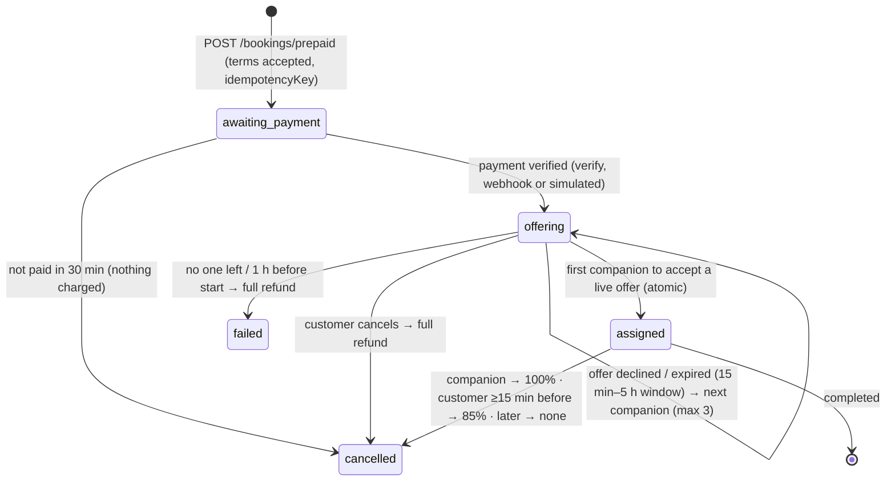

# prsnn API (Supabase)

Project `prsnn` · ref `mhovyhapzhxcmcuelbol` · Mumbai (`ap-south-1`).
SQL and edge functions: `qwink-dinein/prsnn-backend/supabase` (migrations are the source of truth).
Client: `src/services/backend.ts` via `src/lib/supabase.ts`. Types: `src/domain/types.ts`.

Every call is `supabase.rpc(name, args)` to a **security-definer** function that checks
`auth.uid()` and the caller's current role, or a table read behind row-level security. Errors
come back as `{ message }`; the app shows it as is. Logged-out visitors can call only
`list_companions`, `get_companion` and `booking_policy`, and read `settings`.

## Auth

| Step | Call | Notes |
|---|---|---|
| Send code | `auth.signInWithOtp({ phone: '+91…', options: { channel: 'sms', data: { role, otp_channel } } })` | Supabase makes the code; the **Send SMS hook** (`functions/send-sms`) delivers it on WhatsApp (Waplify), SMS (MSG91) as backup. `role: 'companion'` only matters on first sign-up |
| Verify | `auth.verifyOtp({ phone, token, type: 'sms' })` | Creates the account on first verify (trigger → `profiles`; members `verified`, companions `not_submitted`) |
| After every login | `rpc('sync_my_role')` → session user | Applies the superadmin phone list (`private.superadmin_phones`), refuses suspended accounts |
| PIN | on the device only (`src/lib/pin.ts`) | Salted SHA-256 in Keychain/Keystore unlocks the stored session; 5 wrong → OTP again |

Session user: `{ id, role, phone, fullName, is_verified, verification_status, profilePhoto, gender, seeGender, profileVisibility, city, suspended }`.

## Profiles

| RPC | Body | |
|---|---|---|
| `me()` / `my_profile()` | | session shape / full own row |
| `update_my_profile(p)` | `fullName, city, state, area, description, gender, seeGender, profileVisibility (+ visibilityConsent: true), tags, packages (1–12), availability {monday…}, startTime, endTime, photoPath` | whitelisted; times inside the day window |
| `submit_companion_application(p)` | above + `photoPath` (no ID) | → `id_required`: live straight away; staff accounts refused |
| `submit_id_documents(p)` | `idType` (`aadhaar`, `pan`, `driving_licence`, `passport`, `voter_id`), `idFrontPath`, `idBackPath` (Aadhaar, DL, voter ID), `selfiePath` — all in `verification/<uid>/` | → `pending`; companions only; refused once verified |
| `save_push_token(token)` | Expo token or null | a token moving to another account is removed from the old one |
| `delete_my_account()` | | refused while a paid booking is open; keeps a `deleted_accounts` row |

**Companion ID check — at the first booking, not at sign-up.** `verification_status`:
`not_submitted` (profile not finished) → `id_required` (live, listed, can be offered bookings) →
`pending` (ID sent) → `verified` | `rejected` (hidden from members until a new ID is approved).
`accept_offer` refuses with “Verify your ID to accept this booking.” until an ID is on file. A
`pending` companion who accepts **holds** the booking (`allocation.state = 'id_check'`,
`status` stays `pending`): no chat, no unlocked photos, no payout. Staff approval confirms every
held booking (chat opens); rejection re-offers each one to the next companion (or refunds in
full). A held booking still past its deadline (start − 1 h) is cancelled and refunded in full by
the sweeper. Cards carry `idVerified` so members see “New on prsnn” instead of the verified badge.

**Storage.** `avatars/<uid>/…` (public) and `verification/<uid>/…` (private: owner + staff, signed links).
You can only write your own folder. JPG/PNG/WebP/HEIC, 8 MB.

## Companions (privacy applied on the server)

| RPC | |
|---|---|
| `list_companions(see?)` | live (`id_required`, `pending` or `verified`; ID-verified first), not suspended, filtered by the viewer's “show me”; locked profiles → first name, no photo, `locked: true` until a confirmed, paid booking together |
| `get_companion(cid)` | same rules; “Companion not found.” otherwise |

## Prepaid bookings

Rules: the session must be ≥90 min away. Payment is applied once (atomic `markPaid`).
There is one live offer at a time; acceptance is a single conditional update on a live,
unexpired offer, so only one companion can win. Each offer window =
clamp((start − 1 h − now) ÷ 3, 15 min, 5 h); the overall deadline is start − 1 h.
Refunds are claimed atomically (never twice) and retried. Backups must be in the same city,
match the customer's gender preference, be free at that time, and offer the booked duration.
Prices are the same for every companion, so the customer always pays the checkout price;
any difference that could arise on reassignment is retained by the platform
(`platformShare` = amount − `companionShare`), never added to the payout or charged to the customer. The customer never sees which other companions were offered (only
`offerSummary: { tried, liveUntil }`). A companion sees only `myOffer`. Booking state
(`status` + `allocation.state`) and payment state (`paymentStatus` + `refund`) are separate
fields. The 30 s sweeper (`private.tick`) expires offers, moves to the next companion and fails
bookings past their deadline.

### Prices and refunds

`packagePrice` is fixed by duration (₹399 base; 1 h ₹399 · 2 h ₹699 · 3 h ₹999 · 4 h ₹1,299 ·
5 h ₹1,599 · 6 h ₹1,899 · 7 h ₹2,199 · 8 h ₹2,499 · 9 h ₹2,799 · 10 h ₹3,099 · 11 h ₹3,349 ·
12 h ₹3,599). `companionShare` = floor(80%) is set when a companion is assigned; the other 20%
is prsnn.'s share. `pricePerHour` is always 399 and is ignored on update.

| Cancelled by | When | `refund.amount` | `refund.retained` |
|---|---|---|---|
| customer | ≥15 min before start | 85% (rounded) | 15% |
| customer | <15 min before start or later | 0 | 100% |
| companion | any time | 100% | 0 |
| system (nobody accepted) | start − 1 h | 100% | 0 |

These are the **defaults**. A superadmin can change the package prices, the 80/20 split, the
cancellation fee and cutoff, the offer windows, the day window and the headline packages in
the app (Admin → Prices); see §Settings. Changes apply to new bookings only.

Server config (`private.config`, SQL editor): `payment_mode`, `max_offers` (3), `support_email`. Payment window 30 min.

| RPC | Who | |
|---|---|---|
| `booking_policy()` | anyone | fees, matching and refund terms from the prices in force |
| `create_prepaid_booking(p)` | member | `{ companionId, scheduledDate, startTime, duration: '60'…'720', idempotencyKey, acceptTerms: true, message?, city?, area? }` → `{ booking, quote, policy, replayed? }` |
| `payment_mode()` / `simulate_payment(bid, outcome)` | member | `simulated` until Razorpay is wired (`private.config`) |
| `accept_offer(bid)` / `decline_offer(bid)` | companion | atomic; clash with another confirmed or held booking refused; needs an ID on file; a companion whose ID is in review gets `{ idCheck: true }` and the booking is held (`id_check`) |
| `cancel_booking(bid)` | either party | policy below |
| `complete_booking(bid)` | companion | after the session has started |
| `open_dispute(bid, reason)` | either party | paid bookings |
| `my_bookings()` / `incoming_bookings()` / `get_booking(bid)` | | customer sees `offerSummary`, companion only `myOffer` |

Chat: table `messages` (Realtime). Only the two people on a confirmed, paid booking can read or
write; staff can read it only when a dispute exists. Phone numbers are masked on insert.

`private.tick()` runs every 30 s (`pg_cron`): lapses unpaid bookings, expires offers → next
companion, fails bookings past the deadline (full refund), completes sessions 2 h after they end.

## Notifications and push

Table `notifications` (own rows; mark read; delete). Every new row is delivered by
`functions/notify` (cron, 30 s): Expo push to the person's device, and WhatsApp templates for
`booking_offer` (→ `WAPLIFY_TPL_BOOKING_REQUEST`), `booking_confirmed` and unfulfilled refunds.

## Settings

`settings` row `pricing` (public read): `{ packagePrices {1…12}, platformShare, cancellationFee,
cancellationCutoffMinutes, offerMinMinutes, offerMaxMinutes, dayStart, dayEnd, headlineHours }`.
Change with `admin_save_pricing(p, reprice_unpaid)` (superadmin; prices must rise with hours and
fall per hour). New bookings only; `reprice_unpaid` also moves bookings still awaiting payment.

## Admin (ADMIN_SPEC.md)

Roles: **superadmin** = phones in `private.superadmin_phones` (10 digits, added in the SQL editor;
promoted on OTP/PIN login, demoted at the next login once removed). **subadmin** = added by a
superadmin by phone. The website's `admin` role has sub-admin rights. Staff routes re-read the
account on every call, so a removed or suspended admin loses access at once. Sub-admins get
403 on every route marked 💰. Every action writes an `AuditLog { actorId, role, action, target,
before, after, at }` (changed fields only). Suspended accounts can't log in (403) and are hidden
from listings, search and offers.

| RPC | Who |
|---|---|
| `admin_overview()` (money for superadmin), `admin_verifications()` (companions holding a booking first, with `heldBookings` and `heldUntil`), `admin_decide_verification(uid, decision, note)` (approve → held bookings confirmed; reject → re-offered) | staff |
| `admin_users(q, role_filter)`, `admin_user(uid)`, `admin_update_user(uid, p)`, `admin_suspend_user(uid, on_off, reason)`, `admin_delete_user(uid)` | staff (staff targets: superadmin only) |
| `admin_bookings(tab)`, `admin_booking(bid)`, `admin_booking_messages(bid)` (disputes only, logged), `admin_update_booking(bid, p)`, `admin_cancel_booking(bid, reason, refund_amount)`, `admin_reassign_booking(bid, cid)` | staff; a sub-admin cancel flags the refund for a superadmin |
| `admin_disputes(st)`, `admin_reply_dispute(bid, msg, to_whom)`, `admin_close_dispute(bid, resolution)` | staff |
| `admin_refund`, `admin_retry_refund`, `admin_mark_paid`, `admin_override_fee`, `admin_delete_booking` | 💰 superadmin |
| `admin_admins()`, `admin_add_admin(phone)` (invites a number that has no account yet), `admin_remove_admin(uid)` | 💰 superadmin |
| `admin_save_pricing`, `admin_audience()`, `admin_activity(before_at)`, table `broadcasts` | 💰 superadmin |
| `functions/broadcast` `{ audience, title, body }` | 💰 superadmin (checked inside) |

## Owner setup

See `prsnn-backend/supabase/README.md` (phone provider, Send SMS hook, secrets, superadmin numbers, test numbers).

## Round 2 (2026-11-10)

**Sign-in.** Indian numbers: WhatsApp OTP as before. Visitors from abroad: `supabase.auth.signInWithOtp({ email })` →
`verifyOtp({ email, token, type: 'email' })` (Supabase Auth email OTP; the email template must contain `{{ .Token }}`).
The PIN is set straight after verification; email accounts key the PIN on the email. Setup then asks email sign-ups for
`contactPhone` (with country code) and `country`.

| RPC | Who | |
|---|---|---|
| `me()` | signed in | session shape + `email, photoStatus, photoNote, approvalStatus, approvalNote, state, area, categories, contactPhone, country` |
| `save_profile(p)` | signed in | `update_my_profile` keys + `categories` (subset of the five), `contactPhone`, `country`; a new `photoPath` → `photoStatus: pending` |
| `submit_companion_application(p)` | companion | needs a photo and ≥1 category; → `approvalStatus: pending` (staff notified); no ID |
| `resubmit_for_review()` | signed in | after changes were requested → `pending` again |
| `search_localities(state_name, q, city_name)` | anyone | India Post localities (156,912) in a state, by name or PIN; the city's district first; max 40 |
| `city_plans_for(city_name)` | anyone | staff-curated "Popular in <city>" plans |
| `create_prepaid_booking(p)` | member | + `category`, `meetingPlace` (required), `recipient { relation, name, phone, city, state }` |
| `raise_panic(bid)` | either party | from the session start to 1 h after the end, confirmed + paid only; alerts every admin now and every 5 min (sweeper) |
| `resolve_panic(aid, note)` | staff, or whoever pressed it | stops the repeats |
| `admin_approval_counts()`, `admin_approvals('companions' \| 'photos')` | staff | the approval queues |
| `admin_decide_profile(uid, 'approve' \| 'reject', note)` | staff | approve → live (photo approved too) |
| `admin_decide_photo(uid)` | staff | approve a photo |
| `admin_request_changes(uid, 'photo' \| 'profile', reasons[], note)` | staff | → `action_needed` notification with `{ kind: 'fix', target }` |
| `admin_panics(open_only)` | staff | alerts with names, numbers, time and place |
| `admin_city_plans(city)`, `admin_save_city_plan(p)`, `admin_delete_city_plan(id)` | staff | edit "Popular in <city>" |

**Listing.** A companion is listed only when `approvalStatus = approved` (and not suspended, ID not rejected). Photos are
shown to others only when `photoStatus = approved`. Cards carry `categories` and `idVerified`.

**Notifications** carry `action` (`fix`, `rejected`, `approved`, `photo_approved`, `review`, `panic`, `panic_resolved`);
types `action_needed`, `approval`, `panic`. Panic pushes use the Android channel `panic` with high priority.

**WhatsApp.** Panic alerts go through `private.whatsapp_outbox` → `claim_whatsapp()` → the `notify` edge function, template
`WAPLIFY_TPL_PANIC_ALERT` (WHATSAPP_TEMPLATES.md #7), to every staff number and the superadmin list.

## Round 3 (2026-11-14)

**Sessions last until the person ends them.** Supabase refresh tokens have no time limit on
this project, so a session never runs out on its own. The app keeps each person's refresh
token in the Keychain / Keystore (`src/lib/pin.ts`, `saveSession`) and the PIN reopens it.
**Log out only locks the app** (no `auth.signOut()`, which would revoke the session and force a
paid WhatsApp code). A code is needed again only after *Forgot PIN*, five wrong PINs, deleting
the account, or if the server reports the session gone (`sessionIsGone` in `src/domain/login.ts`;
network errors never log anyone out).

**WhatsApp audience.** `claim_notifications()` now returns `toRequester` (the recipient is the
member who booked) and `booking.place`. `functions/notify` sends `booking_offer` → companion only,
`booking_confirmed` → member only, unfulfilled `refund` → member only, `session_reminder` → both.

**5 AM reminder.** New notification type `session_reminder`, column `bookings.reminder_sent_at`,
`private.send_day_reminders()` (pg_cron `prsnn-day-reminders`, every 5 min): from 5:00 AM IST, every
accepted + paid booking that day, confirmed before 5 AM and not started yet, gets one row for the
member and one for the companion (push + `WAPLIFY_TPL_SESSION_REMINDER`). Sent once per booking.

**Panic alert details.** `private.panic_send` adds {{11}} duration + activity and {{12}} the alert
number and first-pressed time (12 variables, WHATSAPP_TEMPLATES.md #7); the staff push carries the
same. Email sign-ups' `contactPhone` is used when there is no login number.

Checks: `scripts/e2e-supabase.mjs` §9 and `prsnn-backend/supabase/tests/round3-notify.sql`
(one transaction, always rolled back).

## Round 4 (2026-11-15)

**Live badges.** `chat_reads (booking_id, user_id, last_read_at)` with RLS (own rows only).
`mark_chat_read(bid)`: participants only, never moves backwards. `unread_counts()` →
`{ notifications, messages, perChat: { bookingId: n }, bookings }` (members: bookings that need
payment; companions: live paid offers). The app recounts on Realtime events on `notifications`,
`messages`, `booking_offers` and `bookings` (all in the `supabase_realtime` publication, RLS
limits rows), on foreground and every 60 s (`src/lib/live.ts`). `profiles` is in the publication
too: a staff change to someone's profile (ID approved, suspended, role) reaches their phone in
seconds without logging out.

**ACID guarantees.** Every RPC runs in one Postgres transaction. Added:
- constraints: one live offer per booking (`booking_offers_one_live`), one open panic per booking,
  non-negative amounts, refund ≤ amount paid, companion share ≤ price, accepted ⇒ companion set;
- `select … for update` on the booking row before any change in `admin_delete_booking`,
  `admin_mark_paid`, `admin_override_fee`, `admin_refund`, `admin_retry_refund`, `complete_booking`,
  `open_dispute`, `simulate_payment`, `private.mark_paid` (accept/decline/cancel already used
  conditional updates with row-count checks);
- delivery outbox: `claim_notifications()` / `claim_whatsapp()` lease rows for 2 minutes (at most 5
  attempts); `functions/notify` reports what the provider accepted with
  `report_notifications([{id, push, wa, error?}])` / `report_whatsapp([{id, ok, error?}])`. A row is
  marked sent only after delivery; push and WhatsApp are tracked separately so a retry never
  repeats the channel that worked. Service role only.

**Staff app preview.** `admin_log_preview(as_role 'member'|'companion', start_at text)`: staff only;
writes `app.preview` to the activity log. The preview itself runs on the app's sample data
(`src/lib/preview.tsx`); nothing else reaches the server.

Checks: `scripts/e2e-supabase.mjs` §10 and `prsnn-backend/supabase/tests/round4-acid.sql`
(rolled back).
