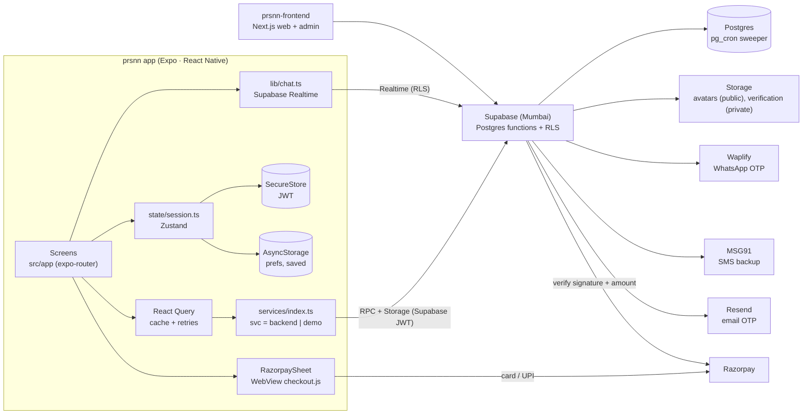
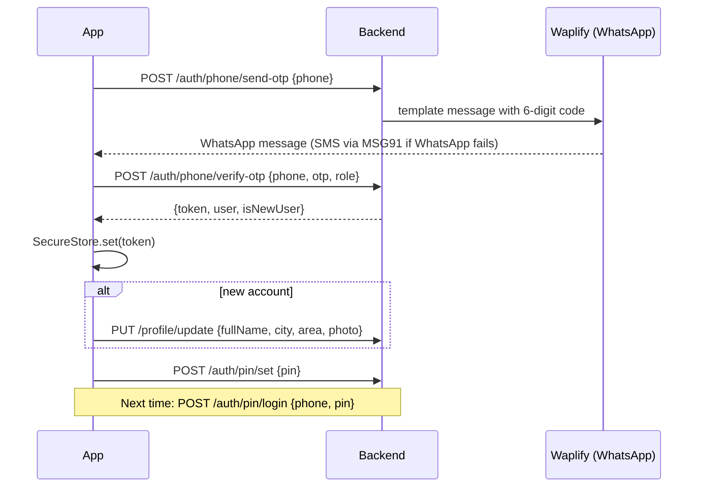
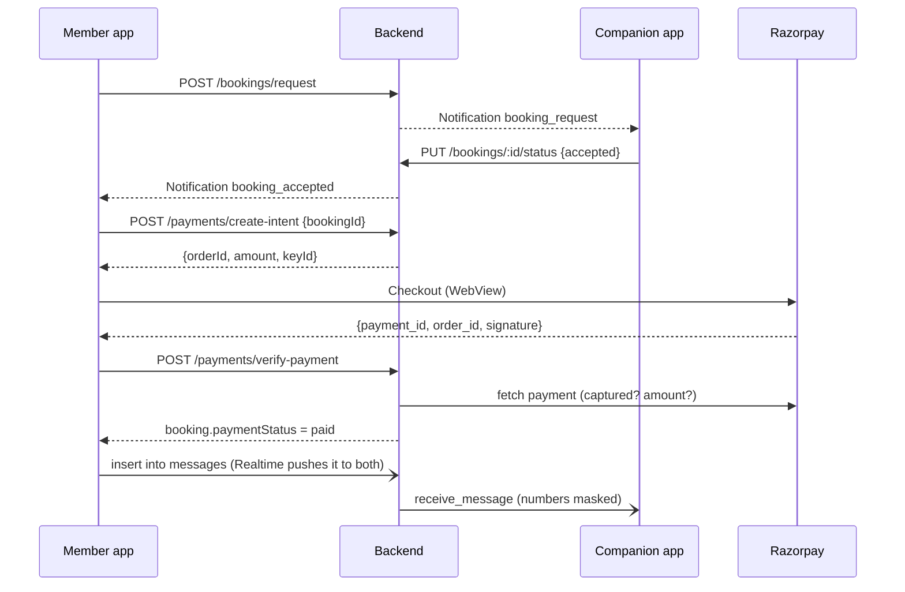

# prsnn mobile — Architecture

## System



The app and the website share **one backend and one database**. Anything
the app needs that the backend didn't have was added to the backend; it was
not faked on the client.

## Folders

```
src/
  app/                 expo-router routes (one file per screen, see design.md)
    (tabs)/            home · search · bookings · messages · profile
    book/ pay/ chat/ booking/ companion/ fellow/
  components/
    ui/                Text, Button, Icon (inline SVG), layout, forms
    companions.tsx     CompanionCard, CompanionRow, HeartButton
    bookings.tsx       BookingCard, stage labels, date formatting
    fellow/            Dashboard, RequestCard, AvailabilityEditor
    RazorpaySheet.tsx  Checkout in a WebView (native) / script (web)
  domain/              PURE logic, unit-tested: pricing, slots, stages, search, phone
  services/            backend.ts (REST), demo.ts (sample data), index.ts (svc + query keys)
  lib/                 supabase client, config, chat (Realtime), local PIN, flows, storage, image picker
  state/session.ts     token, user, prefs (Zustand)
  theme/               tokens.ts (palette), fonts.ts (type scale)
__tests__/             Jest (jest-expo) tests for src/domain
```

**Rule:** screens never call `fetch`. They call `svc.*` through React Query
with keys from `qk`. Business rules (prices, availability, booking stages)
live in `src/domain` and are tested there.

## Auth flow



Existing web accounts use `POST /auth/login` (email or username + password)
and `POST /auth/verify-email` when the email isn't verified yet.

A `401` from any call signs the person out and returns to `/login`
(`setUnauthorizedHandler` in `_layout.tsx`).

## Booking and payment flow



`domain/booking.ts → amountDuePaise()` uses the exact formula of the
backend's `amountDueInPaise()`, so the price shown is the price charged.

## Why these choices

| Choice | Reason |
|---|---|
| Expo 58 + expo-router + RN 0.88 | Same stack as Hyderabad Rishta: one toolchain, EAS builds, OTA updates |
| React Query + Zustand | Server cache vs. small local session state; same as the sister app |
| Razorpay in a WebView, not `react-native-razorpay` | Works in Expo Go and on web, no native module; the server still verifies everything |
| Inline SVG icons | No icon-font download; identical on iOS, Android and web |
| Client-side search over the verified list | The list is ≤100 and cached; filters feel instant and work offline. Move to `/companions/search/:q` past ~500 companions |
| Saved companions on device | The backend has no favourites; adding an endpoint is P2 |
| Demo mode (`EXPO_PUBLIC_DEMO=1`) | Design review, screenshots and store previews without touching real data |

## Environment

| Variable | Default |
|---|---|
| `EXPO_PUBLIC_SUPABASE_URL` | `https://mhovyhapzhxcmcuelbol.supabase.co` |
| `EXPO_PUBLIC_SUPABASE_KEY` | the project's **publishable** key (safe to ship; never the secret/service key) |
| `EXPO_PUBLIC_DEMO` | `0` |

## Backend changes this app depends on

These are on branch `claude/quirky-ramanujan-k68143` of `prsnn-backend`.
See API.md.

1. Phone OTP (Waplify / MSG91) and PIN endpoints.
2. `DELETE /api/profile` (self-service deletion).
3. Optional email/password and partial unique indexes. **Run
   `node src/scripts/migratePhoneAuth.js` once per database before
   deploying.**
4. Security fixes: no OTP or PIN hashes in profile or admin responses, and
   `onboard-basic` can't verify companions.
