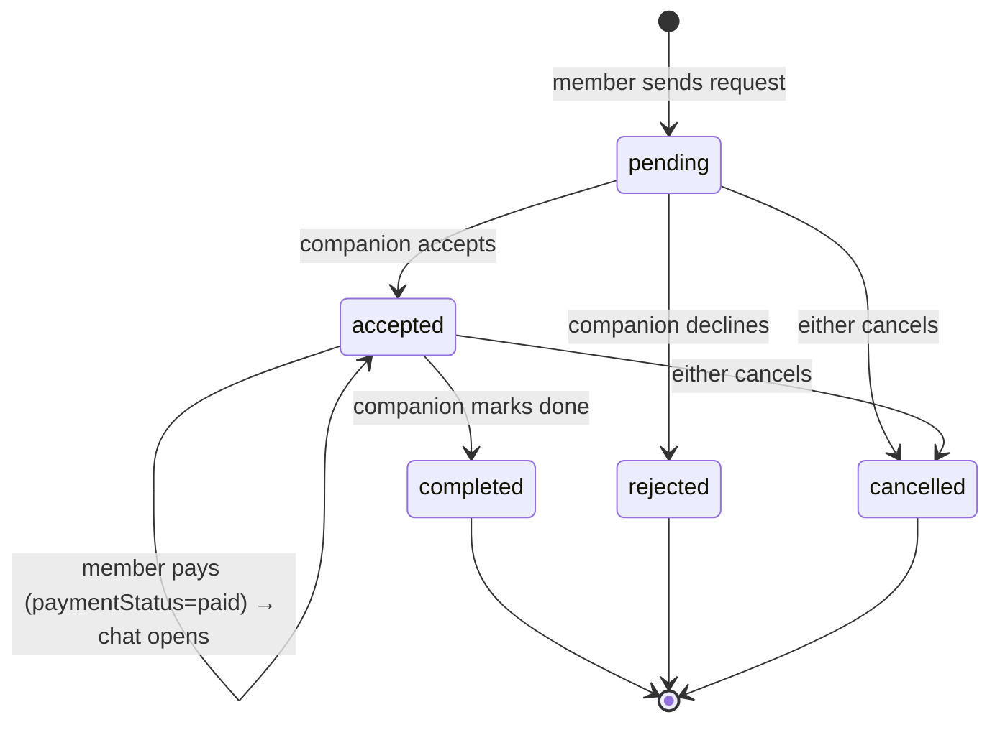

# prsnn mobile — Product Requirements

**prsnn.** Good company, on your terms.
A native iOS and Android app for finding and booking verified companions in
Hyderabad for coffee, walks, events, study and more. It is built on the
existing prsnn backend (`qwink-dinein/prsnn-backend`) and keeps every core
feature of the web app (`qwink-dinein/prsnn-frontend`).

## Who it's for

| Person | Wants | Core job in the app |
|---|---|---|
| **Member** (role `user`) | Company for an activity without going alone | Find → request → pay → chat → meet |
| **Companion** (role `companion`) | Earn by spending time with people, on their own terms | Onboard → get verified → accept requests → chat → get paid |
| **Admin / super admin** | Keep the platform safe | Stay on the **web** admin dashboard (mock-up 22). Not in the app. |

## Core features (must match the web app)

1. **Accounts.** Phone + OTP on WhatsApp (new), a 4-digit PIN for quick
   login (new), and email + password for existing web accounts.
2. **Discover and search** verified companions by name, area, activity
   (tags) and price.
3. **Companion profile** with bio, activities, available days and hours,
   and hourly rate.
4. **Booking request** for a date, start time (inside the companion's hours)
   and duration (30 min to 4 h). The companion **accepts or declines**.
5. **Payment** through Razorpay after acceptance. The server verifies the
   signature, the order, the capture and the amount.
6. **Chat** per booking over Socket.io. It opens after payment for the
   member. Phone numbers are masked by the server.
7. **Notifications** for booking requests, acceptances and payments.
8. **Companion onboarding** with ID front and back, photo, bio, tags, rate,
   days and hours, then **admin verification**.
9. **Companion dashboard and earnings** from paid sessions.
10. **Profile**: edit details, saved companions, PIN, help, legal, log out,
    and **delete account** (an App Store and Play requirement).

## Booking lifecycle (unchanged from the backend)

> **Difference from the mock-up.** Screens 10–12 show *pay → "Booking
> confirmed, companion will confirm shortly"*. The backend only accepts
> payment for an **accepted** booking, so the app runs *request → "Request
> sent" → companion accepts → pay → "Booking confirmed"*. Screen 12 is used
> for both moments. Paying before acceptance would need a backend change and
> a refund flow for declined requests. See Tasks.md, P2.

## Non-goals for v1

- In-app admin tools (they stay on the web).
- Ratings and reviews, wallet, refer-and-earn, payouts setup. The mock-ups
  show these, but the backend has no data for them, so v1 hides them rather
  than showing fake numbers. See Phases.md.
- Google and Apple sign-in. These need OAuth client IDs, and Apple requires
  "Sign in with Apple" whenever Google is offered.
- Dark mode. The brand is light cream. `userInterfaceStyle` is `light`.

## Success measures

- A new member completes OTP → profile → first request in under 2 minutes.
- More than 95% of payments verify on the first try. Verification failures
  show the booking reference and never claim that no money moved.
- Zero phone numbers shown in chat. The server masks them, so no client can
  bypass it.

## Safety rules the app must keep

- Public places only (shown on profile, review and chat screens).
- Companions are bookable only when `verificationStatus === 'verified'`.
- No client-side shortcut to verification. The backend refuses companions on
  `onboard-basic`.
- Tokens live in the Keychain or Keystore (`expo-secure-store`). They are
  never written to logs.
