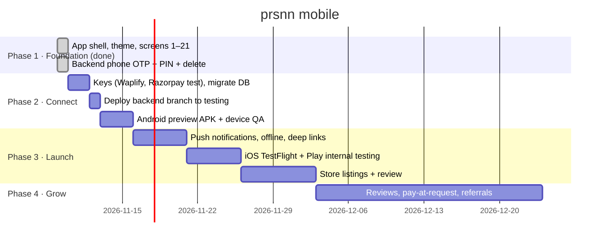

# Phases

## Phase 1: Foundation ✅
The whole member and companion journey works against the real API
contract. Demo mode for review.

**Exit check:** typecheck, lint and unit tests pass; every screen renders
without errors at 375 and 440 wide.

## Phase 2: Connect
Real keys, the testing backend, and a real device.

**Exit check:** on an Android phone, a real WhatsApp OTP arrives, a test
booking is accepted from a second account, a Razorpay test payment
verifies, and chat works both ways.

## Phase 3: Launch
Push notifications, store assets and store review.

**Exit check:** approved on TestFlight and in Play internal testing, plus a
privacy policy and data-safety form matching what the app collects (phone,
name, photo, ID images, payments through Razorpay).

## Phase 4: Grow
The P2 items in Tasks.md, ordered by what members ask for.
